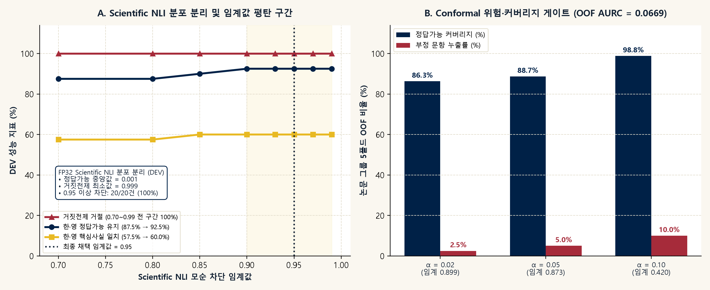

# 논문 질의응답과 근거 추적 (Evidence-Grounded Paper Q&A)

[English](README.md) | [시스템 아키텍처](docs/architecture.ko.md) | [방법론·소거 결정](docs/methodology-and-decisions.ko.md) | [평가 결과](docs/results.ko.md) | [재현·실행 가이드](docs/reproduction.ko.md)

<p align="center">
  
</p>

<strong>논문 질의응답과 근거 추적(Evidence-Grounded Paper Q&A)</strong>은 영문 연구 논문 PDF 한 편에 대해 **한국어 또는 영어**로 질문하고, 답변의 모든 문장을 원문 구절·페이지·섹션과 대조해 검증하는 로컬 이중언어 질의응답 시스템입니다.

BGE-M3 하이브리드 검색과 Parent 1,800자 문맥 확장, 외부 무누설 arXiv 150편 기반 **FP32 Scientific NLI 거짓전제 차단 게이트(임계값 `0.95`)**, **Guided JSON + 결정론적 인용·수치 검증기**, <strong>논문 그룹 5폴드 OOF Conformal Gate(<code>AURC 0.0669</code>)</strong>를 통합했습니다. 모든 설계 결정은 개발 세트(**DEV 10편, 120문항**)의 통제 소거 실험에서 채택·기각했고, 평가 세트(**미공개 Holdout 20편, 240문항**)는 최종 구성을 동결한 뒤 단 1회만 평가했습니다.

---

## 미공개 `corpus30` Holdout 최종 결과 (20편, 240문항)

| 평가 지표 (`corpus30` 미공개 Holdout) | 영어 (`120`) | 한국어 (`120`) | 한·영 동시 통과 (`120`쌍) | 전체 출력 (`240`) |
| --- | ---: | ---: | ---: | ---: |
| 구조화 응답 계약 준수 | `120/120` (`100.0%`) | `120/120` (`100.0%`) | `120/120` (`100.0%`) | **`240/240` (`100.0%`)** |
| 정답가능 문항 유지 (`80`쌍) | `74/80` (`92.5%`) | `68/80` (`85.0%`) | **`68/80` (`85.0%`)** | **`142/160` (`88.8%`)** |
| 필수 핵심사실 전원 일치 (`80`쌍) | `54/80` (`67.5%`) | `41/80` (`51.3%`) | **`33/80` (`41.3%`)** | **`95/160` (`59.4%`)** |
| 허용 정답 페이지 인용 (`80`쌍) | `66/80` (`82.5%`) | `57/80` (`71.3%`) | **`56/80` (`70.0%`)** | **`123/160` (`76.9%`)** |
| 근거부족 안전 거절 (`20`쌍) | **`20/20` (`100.0%`)** | **`20/20` (`100.0%`)** | **`20/20` (`100.0%`)** | **`40/40` (`100.0%`)** |
| 거짓전제 안전 거절 (`20`쌍) | **`20/20` (`100.0%`)** | **`19/20` (`95.0%`)** | **`19/20` (`95.0%`)** | **`39/40` (`97.5%`)** |
| 원문 인용 / 수치 결정론 검증률 | `0.878 / 0.946` | `0.884 / 0.957` | **`0.881 / 0.951`** | **`0.881 / 0.951`** |
| 의미 평가 완전성 (`Qwen3-14B-AWQ`) | **`0.849`** | **`0.711`** | **`0.690`** | 평균 충실도 **`0.888`** |
| 평균 응답 시간 (`vLLM`, NVIDIA L4) | `1.81초/문항` | `1.74초/문항` | **`1.77초/문항`** | 총 `545.3초` |

### 핵심 설계 및 검증 요약

- **이중언어 하이브리드 검색 및 Parent 문맥 확장**: `BM25` + `BAAI/bge-m3`를 `RRF(k=60)`로 결합하고, 한국어 질문은 영문 학술 검색어로 병렬 번역해 `BAAI/bge-reranker-v2-m3` 이중 점수 리랭킹(`0.65 EN + 0.35 KO`) 및 `1,800`자 Parent Window(페이지당 최대 2청크)로 문맥 절단을 방지합니다.
- **무누설 FP32 Scientific NLI 거짓전제 게이트**: `corpus30`과 0% 겹치는 외부 arXiv 150편과 SciFact에서 합성한 한·영 `7,729`개 쌍으로 `MoritzLaurer/mDeBERTa-v3-base-mnli-xnli`를 엄격한 **FP32**로 미세조정(`Val Loss 0.1676`)했습니다. DEV에서 정답가능 모순 중앙값 **`0.001`** 대 거짓전제 최소값 **`0.999`**(`20/20 >= 0.95`)로 깔끔히 분리되었습니다.
- **실증 기반 소거 기각 규율**: DEV 통제 실험에서 사후 2단계 Post NLI(`Exp 2B`: 한국어 답변 `4`건 손실, 거짓전제 추가 이득 `0`건)와 5청크 LoRA SFT(`Exp 3A`: 한국어 핵심사실 `25 -> 22`, 인용 일치율 `0.96 -> 0.93` 하락)를 모두 기각하고, 최종 우승 구성(`Exp 2C`: 제로샷 `Qwen3-4B-Instruct-2507` Guided JSON + FP32 Pre NLI `0.95`)을 채택했습니다.
- **논문 그룹 5폴드 OOF Conformal Gate**: [`reports/calibrated_gate.json`](reports/calibrated_gate.json)에 보정 파라미터를 저장했으며 **OOF AURC `0.0669`**(`alpha=0.05`에서 정답가능 커버리지 `88.7%`, 부정 문항 누출률 `5.0%`; `alpha=0.02`에서 커버리지 `86.3%`, 누출률 `2.5%`)를 달성했습니다.
- **로컬 RTX 3060 및 ONNX 패리티 게이트 실측**: 로컬 배포 검증기([`scripts/verify_local_runtime.py`](scripts/verify_local_runtime.py))가 레거시 TorchScript ONNX INT8의 DeBERTa-v2 패딩 드리프트(`abs_diff = 0.0373 > 0.02`, Holdout 거짓전제 `2/20` 탐지, `275.78 ms/창`)를 자동 차단했고, 로컬 Windows **RTX 3060 6 GB FP32 PyTorch** 경로는 **`1.048 GiB` VRAM**(피크 `1.610 GiB`), **`abs_diff = 0.000000`**, **`26.47 ms/창`**(CPU ONNX 대비 `10.4배` 고속)으로 통과했습니다.

---

## 시각적 검증 요약

### 미공개 Holdout 이중언어 세부 성능 및 의미 평가


### DEV 120문항 단계별 소거 실험 및 기각 근거


### Scientific NLI 분포 분리 및 Conformal 위험 커버리지 보정


### 로컬 FastAPI 인터랙티브 웹 데모 (한국어 UI)


---

## 빠른 실행 및 로컬 인터랙티브 데모

Python 3.10 이상 환경에서 즉시 실행됩니다. 별도 로컬 LLM 서버를 띄우지 않아도 `corpus30` 논문 30편, 미공개 Holdout 검증 프리셋 14건(실시간 NLI 및 Conformal 경계 사례 포함), Conformal Gate 실시간 계산, NLI 패리티 게이트 진단, 새 영문 PDF 업로드를 웹 UI에서 바로 확인할 수 있습니다.

```powershell
# 1. 가상환경 생성 및 의존성 설치
python -m venv .venv
.\.venv\Scripts\python.exe -m pip install -r requirements.txt

# 2. 로컬 인터랙티브 FastAPI 웹 데모 실행 (http://127.0.0.1:8000)
.\launch-paper-qna.bat demo

# 3. 선택: 로컬 OpenAI 호환 Qwen3-4B 서버(llama-server / Ollama) 연결
.\launch-paper-qna.bat demo --llm-url http://127.0.0.1:8080

# 4. CLI 상태 확인 및 단일 질문 실행
.\launch-paper-qna.bat status
.\launch-paper-qna.bat ask --paper-id paper-030 `
  --question "다변량 예측기와 비교한 세 스크리닝 기준선은 무엇인가요?"

# 5. 단위, 응답 계약, Conformal, FastAPI, NLI 패리티 테스트 (9/9 통과)
.\.venv\Scripts\python.exe -m pytest -v
```

Linux 및 macOS에서는 `.\launch-paper-qna.bat` 대신 `sh ./launch-paper-qna.sh`를 사용합니다.

---

## 문서 및 아티팩트 안내

| 문서 / 아티팩트 | 내용 |
| --- | --- |
| [`docs/architecture.ko.md`](docs/architecture.ko.md) | 하이브리드 검색, Scientific NLI 사전 게이트, Guided JSON 검증기, Conformal Gate 전체 구조 |
| [`docs/methodology-and-decisions.ko.md`](docs/methodology-and-decisions.ko.md) | DEV 단계별 소거 실험, 기각된 4가지 가설(BF16 NLI, Post NLI, LoRA SFT, ONNX INT8)과 트러블슈팅 |
| [`docs/results.ko.md`](docs/results.ko.md) | DEV, 미공개 Holdout(`240`문항), Semantic Judge(`160`문항), 로컬 RTX 3060 검증 전체 수치표 |
| [`docs/reproduction.ko.md`](docs/reproduction.ko.md) | 로컬 실행, RTX 3060 `llama.cpp` 연동 및 Colab Enterprise L4 원샷 실험 재현 가이드 |
| [`notebooks/paper_qna_v2_workbench.ipynb`](notebooks/paper_qna_v2_workbench.ipynb) | Colab Enterprise NVIDIA L4 원샷 전체 실험 노트북 |
| [`reports/final-summary.json`](reports/final-summary.json) | DEV, Holdout, Semantic Judge, Conformal Gate, 로컬 검증을 통합한 마스터 JSON |
| [`reports/calibrated_gate.json`](reports/calibrated_gate.json) | 논문 그룹 5폴드 OOF Conformal Gate 보정 파라미터 (`OOF AURC = 0.0669`) |
| [`reports/local_verification.json`](reports/local_verification.json) | 로컬 Windows RTX 3060 FP32 PyTorch 대 CPU ONNX INT8 패리티 게이트 및 SHA-256 감사 로그 |
| [`data/corpus_v2_holdout/freeze_v2.json`](data/corpus_v2_holdout/freeze_v2.json) | 향후 검증용 신규 무누설 arXiv 30편(`677`청크) SHA-256 동결 매니페스트 |

---

## 적용 범위 및 한계

- **텍스트형 영문 PDF 대상**: 스캔 이미지 PDF의 OCR, 그래프 및 표의 시각적 레이아웃 추론, 복잡한 수식 유도, 다중 논문 비교 질의는 현재 범위 밖입니다.
- **어휘 별칭 일치율 대 의미적 완전성**: 쌍체 핵심사실 일치율(`41.3%`)은 한·영 양쪽 문자열에 필수 별칭이 정확히 등장해야 인정하는 엄격한 기준이며, 의미 수준 평가를 위해 `Qwen3-14B-AWQ` Semantic Judge(`EN 0.849`, `KO 0.711`, `충실도 0.888`)와 `160`문항 감사 CSV([`reports/exp4_v2_final_holdout_human_audit.csv`](reports/exp4_v2_final_holdout_human_audit.csv))를 함께 공개합니다.
- **DeBERTa-v2 양자화 민감도**: `mDeBERTa-v3`는 학습 시 `BF16`과 추론 시 레거시 TorchScript 동적 `INT8` 모두에서 수치 불안정성이 관측되므로, 검증된 로컬 추론 경로는 **FP32 PyTorch**(`RTX 3060 1.048 GiB`)를 표준으로 유지합니다.
