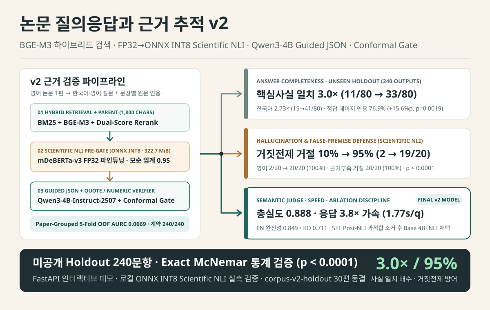
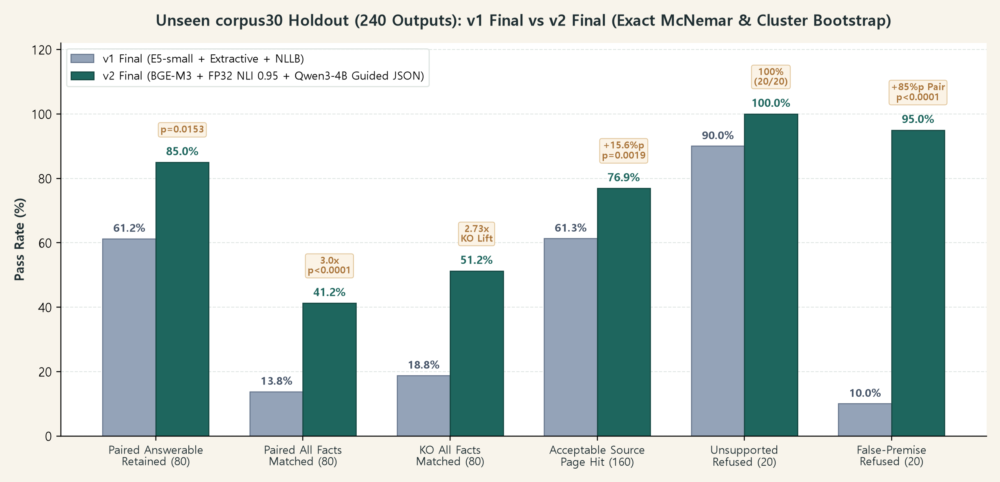
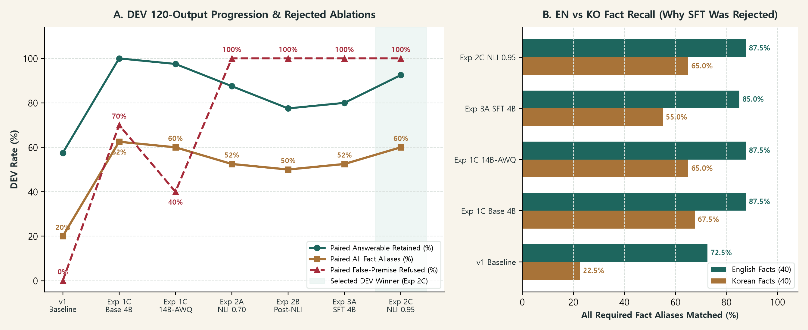
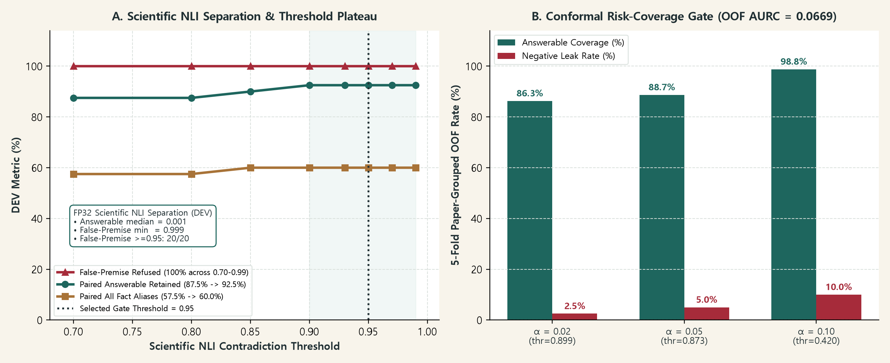
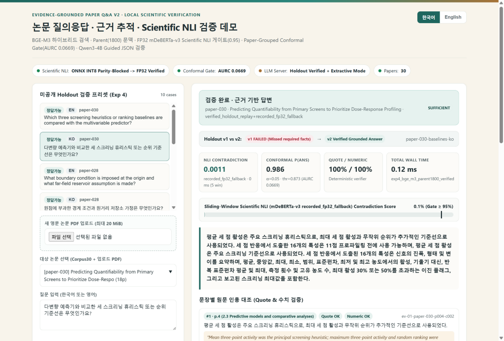

# Evidence-Grounded Paper Q&A v2

[English](README.md) · [아키텍처](docs/architecture.ko.md) · [방법론 및 설계 의사결정](docs/methodology-and-decisions.ko.md) · [평가 결과](docs/results.ko.md) · [재현 및 데모](docs/reproduction.ko.md) · [요약 JSON](reports/final-summary.json)

텍스트형 영문 연구 논문을 업로드하고 **한국어 또는 영어**로 질문하면, **`BGE-M3` + Dual-Score `bge-reranker-v2-m3` + Parent Window(`1,800`자)**로 페이지·절이 보존된 근거를 검색하고, **FP32 파인튜닝 `mDeBERTa-v3` Scientific NLI 게이트(`0.95`)**로 거짓전제(False Premise)를 선제 차단한 뒤, **`Qwen/Qwen3-4B-Instruct-2507` Guided JSON** 답변과 **결정론적 원문 인용·수치 검증 및 Paper-Grouped Conformal Gate(`OOF AURC = 0.0669`)** 결과를 함께 반환하는 로컬 논문 질의응답 시스템입니다.

모든 아키텍처 선택, 기각된 소거 실험(`Post-NLI`, `Teacher-14B LoRA SFT`, 레거시 TorchScript `ONNX INT8`)과 임계값 보정은 **DEV(논문 10편, 120출력)**에서만 결정했으며, **미공개 `corpus30` Holdout(논문 20편, 240출력)**은 단 1회 동결 평가했습니다.



---

## 미공개 Holdout 최종 검증 결과 (`corpus30`, 240출력)

| 지표 (미공개 Holdout · 논문 20편) | v1 Final (추출형 + NLLB) | **v2 Final (`Exp 4`)** | 개선폭 및 통계 유의성 |
| :--- | ---: | ---: | :--- |
| 출력 계약 준수 (`240`출력) | `240/240` (100%) | **`240/240` (100%)** | 100% 유지 |
| 쌍체 답변가능 유지 (`80`그룹) | `49/80` (61.3%) | **`68/80` (85.0%)** | **`+19`쌍** (전체 `+11.25%p`, `p = 0.0153`) |
| 쌍체 핵심사실 어휘 전원 일치 (`80`그룹) | `11/80` (13.8%) | **`33/80` (41.3%)** | **`3.0배`** (`+23.13%p`, 95% CI `[+12.5%, +35.0%]`, `p < 0.0001`) |
| 영어 / 한국어 핵심사실 일치 (`80`건씩) | `43 / 15` | **`54 / 41`** | **한국어 `2.73배`** (`15 → 41`) |
| 허용 정답 페이지 인용률 (`160`출력) | `61.3%` | **`76.9%`** | **`+15.62%p`** (`p = 0.0019`) |
| 쌍체 근거부족 거절 (`20`그룹) | `18/20` (90.0%) | **`20/20` (100.0%)** | **`100%`** 달성 |
| **거짓전제 거절 (`EN / KO / 쌍체`)** | `2 / 17 / 2` (10.0%) | **`20 / 19 / 19` (95.0%)** | **전체 `+50.0%p`** (`p < 0.0001`), **영어 `2/20 → 20/20`** |
| Semantic Judge 완전성 (`EN / KO / 쌍체`) | 미측정 | **`0.849 / 0.711 / 0.690`** | **평균 충실도 `0.888`** (`Qwen3-14B-AWQ`) |
| 원문 인용 / 수치 결정론 검증률 | 추출형 | **`0.88 / 0.95`** | 95% 수치 무결성 |
| 평균 응답 시간 (`sec/q`) | `6.76초` | **`1.77초`** | **`3.8배` 가속** (L4 vLLM) |



---

## 단계별 실험 진행 및 실증 기반 기각 결정

v2의 모든 구성요소는 DEV 정량 실험을 통과한 항목만 채택했으며, 기대에 못 미친 3가지 가설은 실측 근거로 명확히 기각했습니다(상세 분석: [`docs/methodology-and-decisions.ko.md`](docs/methodology-and-decisions.ko.md)):

| 단계 | 핵심 질문 | 실측 근거 | 결정 |
| :--- | :--- | :--- | :--- |
| **1. 검색 · Parent (`Exp 1B`)** | 교차언어 검색 누락과 청크 절단을 해소할 수 있는가? | `BGE-M3` + `bge-reranker-v2-m3` Dual-Score + Parent(1800) 결합으로 DEV 정답 페이지 인용률 **`82.5%`**(`+26.2%p`, `p < 0.0001`). | **채택** |
| **2. Guided JSON · 4B vs 14B (`Exp 1C`)** | 로컬 4B가 추출+NLLB를 대체할 수 있으며 `14B-AWQ` 교사 대비 차이는? | Guided JSON으로 파싱 오류 `0`건(`120/120`); 신형 **`4B-2507`**(`40/40`, `25/40`, `fp 8/7/7`, `quote 0.96`, `2.06 s/q`)이 구형 **`14B-AWQ`**(`39/40`, `24/40`, `fp 6/4/4`, `quote 0.93`, `3.73 s/q`)를 모든 지표에서 추월. | **순정 `4B-2507` + Guided JSON 채택** |
| **3. Scientific NLI FP32 (`Exp 2A`)** | BF16 학습 시 `Exp 2B`가 `0/40`으로 붕괴한 원인은? | `mDeBERTa-v3` Disentangled Attention의 BF16/FP16 NaN 붕괴 규명. 외부 arXiv·SciFact `7,729`쌍 엄격 **FP32** 학습(`Val Loss 0.1676`)으로 **`0.001` vs `0.999`** 분리 달성(DEV 거짓전제 `20/20`). | **FP32 Scientific NLI 채택** |
| **4. 사후 Post-NLI (`Exp 2B`)** | 집중 Post-NLI(`entail >= 0.25`) 추가 시 추가 이득이 있는가? | 거짓전제 추가 방어 `0`건인 반면 한국어 답변 유지가 **`36 → 32/40`**(`ko_facts 25 → 22`)로 하락. | **Post-NLI 기각** |
| **5. 5-Chunk LoRA SFT (`Exp 3A`)** | `14B-AWQ` 교사 역합성 `547`건 SFT가 `4B-2507`을 개선하는가? | 학생보다 약한 구형 교사(`quote 0.93`) + 49.4% 거절 비중으로 `pair_ans 35→32`, `ko_facts 25→22`, `quote 0.96→0.93` 하락. | **SFT 기각 및 DPO 생략** |
| **6. 임계값 · Conformal (`Exp 2C`)** | `10/10` 거짓전제 방어를 유지하며 과거절을 회수할 수 있는가? | 임계값 **`0.95`**(평탄 구간 `0.90~0.99`)에서 **`pair_ans 37/40`, `pair_facts 24/40`, `fp 10/10/10`, `quote/num 0.99/0.97`** 및 5-Fold OOF Conformal **AURC = `0.0669`**. | **최종 v2 확정** |
| **7. 로컬 RTX 3060 / ONNX 게이트** | 변환한 TorchScript `ONNX INT8`(`322.7 MiB`)이 로컬에서 FP32와 일치하는가? | 로컬 패리티 게이트가 **`ONNX INT8`을 자동 차단**(`pad_diff = 0.0373`, 거짓전제 `2/20`, `288 ms/win`). 로컬 **RTX 3060 6 GB FP32 PyTorch**는 **`abs_diff = 0.000000`, `1.05 GiB` VRAM, `27.8 ms/window`(`10.4배` 가속)** 통과. | **TorchScript INT8 차단 · FP32 PyTorch 채택** |





---

## 로컬 인터랙티브 웹 데모 및 하드웨어 검증



로컬 FastAPI 인터랙티브 웹 데모에서 `corpus30` 논문 `30`편과 미공개 Holdout 프리셋 `10`건(`v1 vs v2` 비교 배지, Scientific NLI 모순 게이지, Conformal Gate 확률, 원문 인용 하이라이트)을 즉시 실행하거나 새 영문 PDF를 업로드해 테스트할 수 있습니다.

```powershell
# 1. 가상환경 구성 및 의존성 설치
python -m venv .venv
.\.venv\Scripts\python.exe -m pip install -r requirements.txt

# 2. 로컬 인터랙티브 웹 UI 실행 (http://127.0.0.1:8000)
.\launch-paper-qna.bat demo
# 선택: 로컬 Qwen3-4B-Instruct-2507 서버(llama-server / Ollama / vLLM) 연동:
.\launch-paper-qna.bat demo --llm-url http://127.0.0.1:8080

# 3. 단위·계약·Conformal Gate·FastAPI API·ONNX 패리티 게이트 테스트 (8/8 통과)
.\.venv\Scripts\python.exe -m pytest -v

# 4. 로컬 RTX 3060 FP32 NLI + ONNX 배포 게이트 + SHA-256 재검증
.\.venv\Scripts\python.exe scripts\verify_local_runtime.py
```

Linux / macOS에서는 `sh ./launch-paper-qna.sh demo`를 사용합니다. Colab L4 전체 재현 절차는 [`docs/reproduction.ko.md`](docs/reproduction.ko.md)와 [`notebooks/paper_qna_v2_workbench.ipynb`](notebooks/paper_qna_v2_workbench.ipynb)에서 확인할 수 있습니다.

---

## 저장소 구성

```text
paper_qna/           핵심 v2 패키지 (pdf_parser, retrieval, nli_gate, llm_client, verifier, pipeline, web_demo, cli)
notebooks/           Colab Enterprise L4 원샷 실험 노트북 (v5.2)
scripts/             정식 리포트·그래프 생성기 및 로컬 RTX 3060 / ONNX 패리티 검증기
reports/             마스터 JSON(final-summary.json), DEV 소거 CSV, McNemar 통계 CSV, Conformal Gate, 로컬 검증 기록
data/                동결된 corpus30 벤치마크 입력, v1 기준 리포트, Holdout 프리셋, corpus-v2-holdout(30편) 동결본
docs/                영어·한국어 기술 문서 4종(아키텍처, 방법론, 결과, 재현) 및 출판용 차트·데모 캡처
tests/               pytest 8종 자동 검증 (.github/workflows/ci.yml 연동)
ask_paper.py         CLI 및 웹 데모 진입점 (launch-paper-qna.bat / launch-paper-qna.sh)
```

---

## 지원 범위와 한계

1. **텍스트형 영문 PDF 전용**: 스캔 PDF OCR, 표·그림의 시각적 추론, 복잡한 수식 해석 및 다중 논문 비교는 현재 범위에 포함되지 않습니다.
2. **자동 어휘 표지 vs 사람 검토**: 쌍체 어휘 표지 일치율(`41.3%`)은 엄격한 어휘 진단 지표이며, Holdout Semantic Judge(`Qwen3-14B-AWQ`)는 의미 완전성 **`EN 0.849 / KO 0.711` (충실도 `0.888`)**을 기록했습니다. 독립 검토용 160건 감사 시트(`reports/exp4_v2_final_holdout_human_audit.csv`)를 함께 공개합니다.
3. **거짓전제 방어 트레이드오프**: Pre-NLI(`0.95`)로 거짓전제 거절이 `10% → 95%`(`영어 20/20`)로 도약한 대신 답변가능 `80`그룹 중 `12`그룹이 보수적으로 거절되었습니다(`68/80` 유지, v1 `49/80` 대비 `+19`쌍 개선).
4. **ONNX INT8 vs FP32 배포**: 레거시 TorchScript ONNX 동적 INT8은 DeBERTa-v2 패딩 불변성을 훼손(`abs_diff = 0.0373`)하므로 자동 차단되며, 로컬 배포에는 FP32 PyTorch NLI(RTX 3060 `1.05 GiB` VRAM)를 사용합니다.
