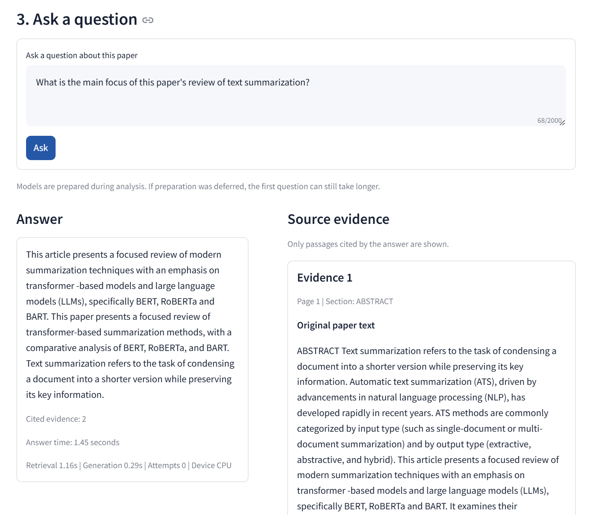
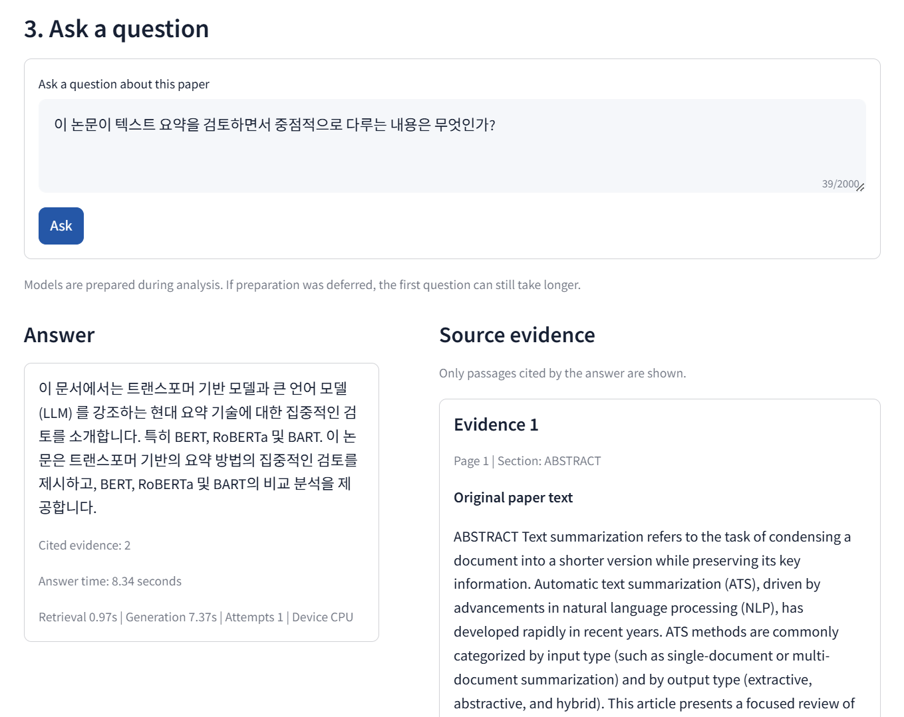
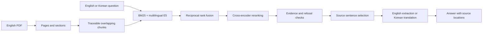

# Evidence-Grounded Paper Q&A

[English](README.md) | [한국어](README_KO.md)

A local application that retrieves evidence from one English research paper and answers questions in English or Korean. It combines hybrid retrieval, cross-encoder reranking, extractive answers, Korean translation and source tracing in a FastAPI and Streamlit service.

The project demonstrates an end-to-end paper Q&A system and reproducible evaluation. Current answers still omit requested details, mistranslate technical terms and sometimes answer unsupported requests. The published measurements expose these limits.

This portfolio version is finalized as a research prototype. Three development strategies failed the predefined adoption criteria, so experimental context expansion and retrieval retries remain disabled by default. Source-to-answer alignment and the measured evaluation artifacts are retained. See the [portfolio case study](https://park-dongmyung.com/projects/project-01/), [final results](docs/results.md) and [experiment decisions](docs/experiments.md).

## Demo

| English answer and evidence | Korean answer and evidence |
| --- | --- |
|  |  |

Additional screens: [upload](docs/assets/screenshots/01-upload.png), [paper overview](docs/assets/screenshots/02-analysis-complete.png), [Docker images](docs/assets/screenshots/docker.png). Screenshots illustrate the interface; they do not certify answer quality.

## Engineering work

- Parse a text-based PDF into page-aware sections and overlapping chunks, preserving source identifiers.
- Fuse BM25 and multilingual E5 retrieval with reciprocal rank fusion, then rerank candidates with a multilingual cross-encoder.
- Construct English answers from selected source sentences and translate them into Korean with a pinned NLLB model, protected terminology and numerical checks.
- Apply bounded premise, requested-aspect and refusal checks; attach original text, page, section and chunk IDs to accepted citations.
- Serve uploads and analysis jobs through FastAPI with a bilingual Streamlit interface and local Docker Compose deployment.
- Evaluate bilingual meaning groups, separate development papers from frozen evaluation papers, preserve source hashes and report cold/warm stage timings.
- Implement and evaluate compound-request tracking and source windows as experimental features; expose source-to-answer alignment in the default service.

## Architecture



The default runtime uses extraction and translation. Generative model trials are documented separately in [experiments](docs/experiments.md). See [architecture](docs/architecture.md) and [answer policy](docs/answer_policy.md) for implementation details.

## Measured results

All 30 source papers were evaluated with 180 English/Korean meaning groups and 360 outputs per version. Ten papers supplied DEV questions; twenty papers supplied the final comparison. A paired group passes only when both languages pass.

The twenty evaluation papers contain 80 answerable, 20 unsupported and 20 false-premise groups:

| Automatic check | Baseline | Final |
| --- | ---: | ---: |
| Valid response contract | 240/240 | 240/240 |
| Answerable request receives an answer | 50/80 | 49/80 |
| All required fact aliases present | 11/80 | 11/80 |
| Acceptable source page cited | 32/80 | 31/80 |
| Unsupported request refused | 18/20 | 18/20 |
| False-premise request refused | 2/20 | 2/20 |
| Semantic accuracy | Not independently measured | Not independently measured |

Fact aliases are a lexical completeness diagnostic, not answer accuracy. Output retention and citation positions also do not prove correctness. Labels use AI-assisted source curation; independent human factual review remains pending. Pre-formal baseline and candidate executions were interrupted and excluded; their answers and scores were not inspected or used for tuning according to the operator record; progress counts and case IDs were read. Formal comparison followed the final source freeze. This history is disclosed in [results](docs/results.md).

The [benchmark inputs and results](data/benchmarks/corpus30/README.md) and both measured source snapshots are public. The older four-paper and historical retrieval evaluations remain separate regression evidence.

## Run locally

Install Docker Desktop, then run from the repository root:

```bash
docker compose up --build -d
docker compose ps
```

- UI: `http://127.0.0.1:8501`
- API documentation: `http://127.0.0.1:8000/docs`
- Health: `http://127.0.0.1:8000/health`

The first analysis can take several minutes while pinned models download. The UI waits up to 600 seconds. Upload one text-based English PDF, up to 20 MiB, then ask an English or Korean question and inspect the cited original text.

```bash
docker compose down
```

Named volumes retain uploads and models. Add `--volumes` only if those data should also be removed. See [Docker setup](docs/deployment/docker.md) for dependencies, model licensing and troubleshooting. The default Korean translation model has a noncommercial license.

## Verify and reproduce

Public artifact checks run without model downloads or private PDFs in Python 3.12:

```bash
python -m pip install -r requirements-test.txt
python -B scripts/verify_project.py
```

Model-backed evaluation requires `requirements.txt`; [results](docs/results.md), [scripts](scripts/README.md) and the [external review procedure](docs/third_party_review.md) explain the commands and what each check establishes. The 382 regression tests pass. A separate Linux runtime regenerated embeddings from all thirty papers and reproduced twelve preselected answer, source-alignment and citation outputs. [Reproduction records](data/benchmarks/corpus30/results/reproduction/README.md) describe the sample on the same physical host. Independent human factual review remains pending.

Frozen artifacts and historical snapshots retain their original bytes through `.gitattributes`. Changes invalidate their recorded hashes. Public verification skips private corpus checks unless the 30 original PDFs and dense cache are present.

## Repository

```text
app/       API, analysis jobs, storage and Q&A service
ui/        bilingual Streamlit interface
config/    model revisions and runtime policies
scripts/   ingestion, evaluation and verification commands
tests/     regression and artifact integrity tests
data/      licensed fixtures, final measurements and measured source snapshots
docs/      English documentation with Korean companion pages
```

Daily work journals, personal notes, temporary outputs, uploaded PDFs and model caches are excluded from publication. Frozen experiment evidence supporting adoption and stopping decisions is public. Final evaluation evidence remains public for verification. The boundary is checked against Git's tracked and eligible files.

## Scope and documentation

Text-based English PDFs only. OCR, visual table/figure reasoning, reliable formula interpretation, multi-paper comparison, accounts and public hosting are outside the current implementation. Retrieved citations are inspectable evidence, not a guarantee of scientific correctness.

- [Documentation index](docs/README.md)
- [Current results and failure analysis](docs/results.md)
- [Bounded model experiments](docs/experiments.md)
- [Architecture](docs/architecture.md)
- [Quality benchmark](docs/quality_benchmark.md)
- [Historical failure cases](docs/failure_cases.md)
- [Data and licensing](docs/data.md)
