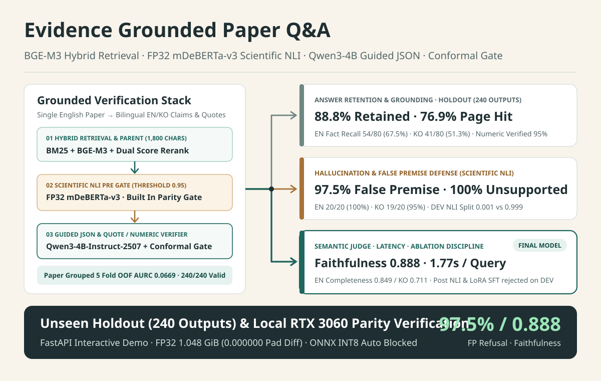
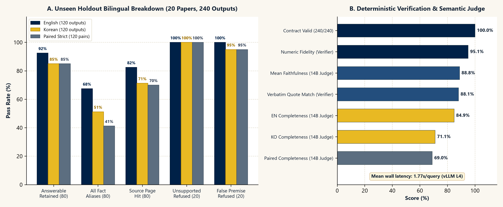
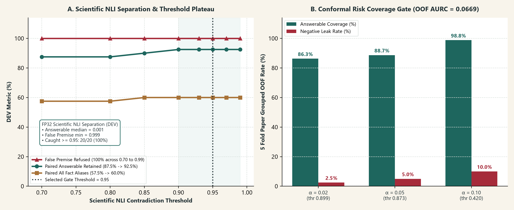
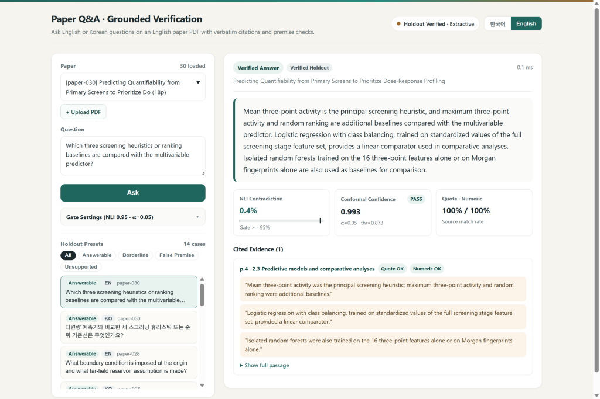

# Evidence Grounded Paper Q&A

> **Language**: **English** | [한국어 (Korean)](README.ko.md)

[](https://github.com/Dongmyung378/Evidence-Grounded-Paper-QnA/actions/workflows/ci.yml)
[](pyproject.toml)
[](tests/test_paper_qna_v2.py)

<p align="center">
  
</p>

**Evidence Grounded Paper Q&A** is a local bilingual (English and Korean) scientific paper question answering and verification system. Given a single English research paper PDF, the system answers English or Korean questions with sentence level source citations, verbatim quote verification, numeric fidelity checks, a fine tuned FP32 Scientific NLI false premise gate, and a Paper Grouped 5 Fold Out of Fold (OOF) Conformal Risk Coverage Gate.

Every architectural choice was verified through controlled DEV ablations (`10` papers, `120` outputs), including explicit evidence based rejections of BF16 NLI training, post generation NLI filtering, 14B teacher LoRA SFT, and a degraded TorchScript ONNX INT8 export caught by a runtime padding invariance gate. The locked unseen Holdout (`20` papers, `240` outputs) was evaluated once after freezing the pipeline.

---

## Key Verified Results (Unseen `corpus30` Holdout, 240 Outputs)

| Metric (`corpus30` Unseen Holdout, 20 Papers) | English (`120`) | Korean (`120`) | Paired Strict (`120` pairs) | All Outputs (`240`) |
| --- | ---: | ---: | ---: | ---: |
| Structured Contract Valid | `120/120` (`100.0%`) | `120/120` (`100.0%`) | `120/120` (`100.0%`) | **`240/240` (`100.0%`)** |
| Answerable Retained (`80` pairs) | `74/80` (`92.5%`) | `68/80` (`85.0%`) | **`68/80` (`85.0%`)** | **`142/160` (`88.8%`)** |
| All Required Fact Aliases (`80` pairs) | `54/80` (`67.5%`) | `41/80` (`51.3%`) | **`33/80` (`41.3%`)** | **`95/160` (`59.4%`)** |
| Acceptable Source Page Hit (`80` pairs) | `66/80` (`82.5%`) | `57/80` (`71.3%`) | **`56/80` (`70.0%`)** | **`123/160` (`76.9%`)** |
| Unsupported Safely Refused (`20` pairs) | **`20/20` (`100.0%`)** | **`20/20` (`100.0%`)** | **`20/20` (`100.0%`)** | **`40/40` (`100.0%`)** |
| False Premise Refused (`20` pairs) | **`20/20` (`100.0%`)** | **`19/20` (`95.0%`)** | **`19/20` (`95.0%`)** | **`39/40` (`97.5%`)** |
| Verbatim Quote / Numeric Fidelity | `0.878 / 0.946` | `0.884 / 0.957` | **`0.881 / 0.951`** | **`0.881 / 0.951`** |
| Semantic Judge Completeness (`Qwen3-14B-AWQ`) | **`0.849`** | **`0.711`** | **`0.690`** | Mean Faithfulness **`0.888`** |
| Mean Wall Latency (`vLLM`, NVIDIA L4) | `1.81 s/q` | `1.74 s/q` | **`1.77 s/q`** | `545.3s` total |

### Core System Highlights

- **Bilingual Hybrid Retrieval & Parent Context**: `BM25` + `BAAI/bge-m3` fused with `RRF(k=60)`, cross lingual Korean to English query translation, Dual Score `BAAI/bge-reranker-v2-m3` (`0.65 EN + 0.35 KO`), and `1,800` character Parent Window expansion (`max 2` chunks per page).
- **Zero Overlap FP32 Scientific NLI False Premise Gate**: `MoritzLaurer/mDeBERTa-v3-base-mnli-xnli` fine tuned strictly in **FP32** on `7,729` EN/KO premise pairs synthesized from `150` external arXiv papers (`0%` overlap with `corpus30`) plus SciFact (`Val Loss 0.1676`). On DEV, answerable contradiction median is **`0.001`** vs false premise minimum **`0.999`** (`20/20 >= 0.95`).
- **Disciplined DEV Ablation & Rejections**: Both 2 Stage Post NLI (`Exp 2B`, lost `4` Korean answers with `0` false premise gain) and 5 Chunk LoRA SFT (`Exp 3A`, degraded Korean fact recall `25 -> 22` and quote match `0.96 -> 0.93`) were explicitly rejected on DEV. Final winner (`Exp 2C`): zero shot `Qwen/Qwen3-4B-Instruct-2507` with Guided JSON + FP32 Pre NLI (`0.95`).
- **Paper Grouped 5 Fold OOF Conformal Gate**: Calibrated in [`reports/calibrated_gate.json`](reports/calibrated_gate.json) with **OOF AURC `0.0669`** (`alpha=0.05`: `88.7%` answerable coverage at `5.0%` negative leak rate; `alpha=0.02`: `86.3%` coverage at `2.5%` leak).
- **Local RTX 3060 & ONNX Parity Gate Audit**: Automated padding invariance verification ([`scripts/verify_local_runtime.py`](scripts/verify_local_runtime.py)) detected `mDeBERTa-v3` TorchScript dynamic INT8 padding drift (`abs_diff = 0.0373 > 0.02`, catching only `2/20` Holdout false premises) and blocked it automatically, while verifying local Windows **RTX 3060 6 GB FP32 PyTorch** at **`1.048 GiB` VRAM** (`1.610 GiB` peak), **`abs_diff = 0.000000`**, and **`27.79 ms/window`** (`10.4x` faster than CPU ONNX).

---

## Visual Summary

### Unseen Holdout Performance & Semantic Verification


### DEV 120 Output Controlled Ablation & Rejection Evidence


### Scientific NLI Threshold Plateau & Conformal Risk Coverage Gate


### Local Interactive FastAPI Web Demo (English UI)


---

## Quickstart & Local Interactive Demo

The repository runs directly on Windows, macOS, and Linux with Python 3.10+. Even without an external LLM server, the interactive web demo loads all `30` benchmark papers, `14` verified unseen Holdout presets (including live NLI and Conformal borderline cases), live Conformal Gate calibration, runtime NLI parity checks, and live English PDF upload.

```powershell
# 1. Create a virtual environment and install dependencies
python -m venv .venv
.\.venv\Scripts\python.exe -m pip install -r requirements.txt

# 2. Launch the interactive FastAPI web demo (http://127.0.0.1:8000)
.\launch-paper-qna.bat demo

# 3. Optional: attach a local OpenAI compatible Qwen3-4B-Instruct-2507 server (llama-server / Ollama)
.\launch-paper-qna.bat demo --llm-url http://127.0.0.1:8080

# 4. Run CLI query or inspect runtime status
.\launch-paper-qna.bat status
.\launch-paper-qna.bat ask --paper-id paper-030 --question "Which three screening heuristics or ranking baselines are compared with the multivariable predictor?"

# 5. Run automated unit, contract, Conformal Gate, FastAPI, and parity gate tests (9/9 pass)
.\.venv\Scripts\python.exe -m pytest -v
```

On Linux and macOS, replace `.\launch-paper-qna.bat` with `sh ./launch-paper-qna.sh`.

---

## Documentation & Artifacts

| Document / Artifact | Description |
| --- | --- |
| [`docs/architecture.md`](docs/architecture.md) | End to end retrieval, Scientific NLI gate, Guided JSON verifier, and Conformal Gate architecture |
| [`docs/methodology-and-decisions.md`](docs/methodology-and-decisions.md) | Staged DEV ablations, rejected hypotheses (BF16 NLI, Post NLI, LoRA SFT, ONNX INT8), and troubleshooting |
| [`docs/results.md`](docs/results.md) | Complete DEV, unseen Holdout (`240` outputs), Semantic Judge (`160` outputs), and local RTX 3060 verification tables |
| [`docs/reproduction.md`](docs/reproduction.md) | Local reproduction, optional RTX 3060 `llama.cpp` server setup, and Colab L4 one shot workbench guide |
| [`notebooks/paper_qna_v2_workbench.ipynb`](notebooks/paper_qna_v2_workbench.ipynb) | End to end Colab Enterprise NVIDIA L4 experimental workbench notebook |
| [`reports/final-summary.json`](reports/final-summary.json) | Canonical machine readable summary combining DEV, Holdout, Semantic Judge, Conformal Gate, and local hardware audit |
| [`reports/calibrated_gate.json`](reports/calibrated_gate.json) | Zero pickle Paper Grouped 5 Fold OOF Conformal Gate parameters (`OOF AURC = 0.0669`) |
| [`reports/local_verification.json`](reports/local_verification.json) | Local Windows RTX 3060 FP32 PyTorch vs CPU ONNX INT8 parity gate and SHA-256 verification log |
| [`data/corpus_v2_holdout/freeze_v2.json`](data/corpus_v2_holdout/freeze_v2.json) | SHA-256 frozen manifest for `30` new zero overlap arXiv papers (`677` chunks) reserved for future validation |

---

## Scope & Limitations

- **Text based English PDFs only**: Scanned OCR PDFs, visual chart/table layout reasoning, symbolic equation derivation, and multi paper synthesis are outside the current scope.
- **Strict lexical alias recall vs semantic completeness**: Paired all fact alias match (`41.3%`) requires exact string aliases in both languages; `Qwen3-14B-AWQ` Semantic Judge scores (`EN 0.849`, `KO 0.711`, `Faithfulness 0.888`) and human audit CSVs (`reports/exp4_v2_final_holdout_human_audit.csv`) are provided side by side.
- **DeBERTa-v2 quantization sensitivity**: `mDeBERTa-v3` exhibits numerical instability under both `BF16` training and legacy TorchScript dynamic `INT8` export; strict FP32 PyTorch (`1.048 GiB` VRAM on RTX 3060) is enforced as the verified runtime path.
