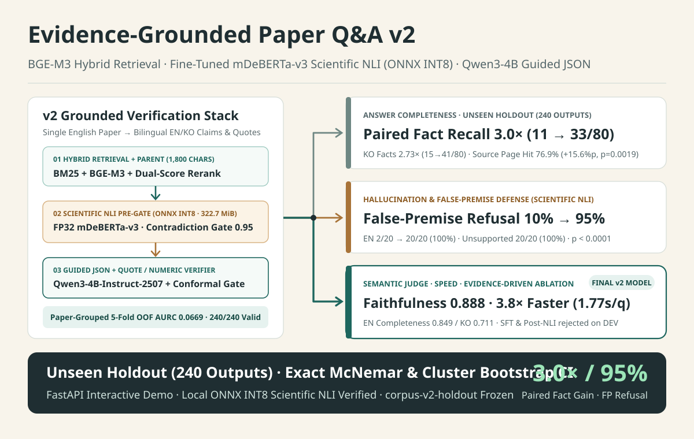
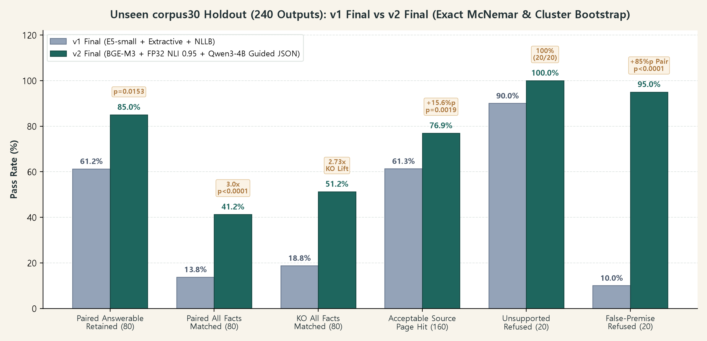
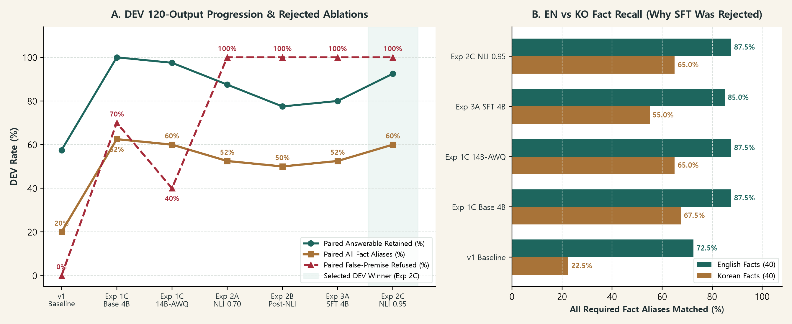
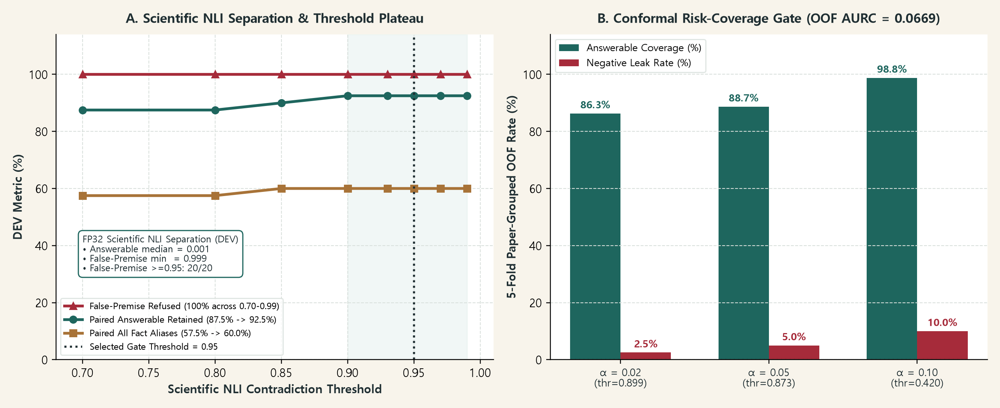
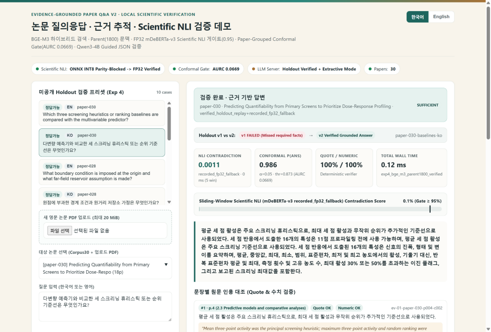

# Evidence-Grounded Paper Q&A v2

[한국어](README.ko.md) · [Architecture](docs/architecture.md) · [Design Decisions & Progression](docs/methodology-and-decisions.md) · [Results](docs/results.md) · [Reproduction & Demo](docs/reproduction.md) · [Summary JSON](reports/final-summary.json)

Upload a text-based English research paper and ask a question in **English or Korean**. The system retrieves page- and section-traceable context with **`BGE-M3` + Dual-Score `bge-reranker-v2-m3` + Parent Window (`1,800` chars)**, blocks false-premise questions using a **fine-tuned FP32 `mDeBERTa-v3` Scientific NLI gate (`thr = 0.95`)**, generates structured claims with **`Qwen/Qwen3-4B-Instruct-2507` (Guided JSON)**, and enforces deterministic **verbatim-quote, numeric-fidelity, and Paper-Grouped Conformal Gate (`OOF AURC = 0.0669`)** verification.

All modeling choices, rejected ablations (`Post-NLI`, `Teacher-14B LoRA SFT`, and legacy TorchScript `ONNX INT8`), and threshold calibration were decided strictly on **DEV (`10` papers, `120` outputs)** before running a single locked evaluation on the **unseen `corpus30` Holdout (`20` papers, `240` outputs)**.



---

## Verified Unseen Holdout Results (`corpus30`, 240 Outputs)

| Metric (Unseen Holdout · 20 Papers) | v1 Final (Extractive + NLLB) | **v2 Final (`Exp 4`)** | Delta & Significance |
| :--- | ---: | ---: | :--- |
| Valid response contract (`240` outputs) | `240/240` (100%) | **`240/240` (100%)** | 100% preserved |
| Paired answerable retained (`80` groups) | `49/80` (61.3%) | **`68/80` (85.0%)** | **`+19` pairs** (`+11.25%p` all, `p = 0.0153`) |
| Paired all required fact aliases (`80` groups) | `11/80` (13.8%) | **`33/80` (41.3%)** | **`3.0×`** (`+23.13%p`, 95% CI `[+12.5%, +35.0%]`, `p < 0.0001`) |
| English / Korean all fact aliases (`80` each) | `43 / 15` | **`54 / 41`** | **Korean `2.73×`** (`15 → 41`) |
| Acceptable source page cited (`160` outputs) | `61.3%` | **`76.9%`** | **`+15.62%p`** (`p = 0.0019`) |
| Paired unsupported refused (`20` groups) | `18/20` (90.0%) | **`20/20` (100.0%)** | **`100%`** refusal |
| **False-premise refused (`EN / KO / Paired`)** | `2 / 17 / 2` (10.0%) | **`20 / 19 / 19` (95.0%)** | **`+50.0%p` all** (`p < 0.0001`), **EN `2/20 → 20/20`** |
| Semantic Judge (`EN / KO / Paired` completeness) | Not measured | **`0.849 / 0.711 / 0.690`** | **Mean faithfulness `0.888`** (`Qwen3-14B-AWQ`) |
| Deterministic Quote / Numeric verified | Extractive | **`0.88 / 0.95`** | 95% numeric fidelity |
| Mean wall latency (`sec/q`) | `6.76 s/q` | **`1.77 s/q`** | **`3.8×` faster** (L4 vLLM) |



---

## Experimental Progression & Evidence-Driven Rejections

Every module in v2 survived DEV ablation; three hypothesized additions were **explicitly rejected** on measured evidence (full breakdown in [`docs/methodology-and-decisions.md`](docs/methodology-and-decisions.md)):

| Stage | Core Question | Measured Evidence | Decision |
| :--- | :--- | :--- | :--- |
| **1. Retrieval + Parent (`Exp 1B`)** | Fix cross-lingual recall and chunk boundary truncation? | `BGE-M3` + `bge-reranker-v2-m3` Dual-Score + Parent(1800) lifted DEV source page hit to **`82.5%`** (`+26.2%p`, `p < 0.0001`). | **Adopt** |
| **2. Guided JSON + 4B vs 14B (`Exp 1C`)** | Can `Qwen3-4B-Instruct-2507` beat extractive+NLLB and how close is it to `14B-AWQ`? | Guided JSON eliminated parse errors (`120/120` valid); **`4B-2507`** (`40/40`, `25/40`, `fp 8/7/7`, `quote 0.96`, `2.06 s/q`) outperformed older-gen **`14B-AWQ`** (`39/40`, `24/40`, `fp 6/4/4`, `quote 0.93`, `3.73 s/q`). | **Adopt Base `4B-2507` + Guided JSON** |
| **3. Scientific NLI FP32 Fix (`Exp 2A`)** | Why did BF16 `mDeBERTa-v3` collapse `Exp 2B` to `0/40`? | Disentangled attention suffered BF16/FP16 NaN collapse. Strict **FP32** fine-tuning on `7,729` zero-overlap arXiv/SciFact pairs (`Val Loss 0.1676`) achieved **`0.001` vs `0.999`** separation (`20/20` DEV false premises). | **Adopt FP32 Scientific NLI** |
| **4. Post-Hoc NLI (`Exp 2B`)** | Does focused Post-NLI (`entail >= 0.25`) help beyond Pre-NLI? | Zero false-premise gain (`10/10/10`) while dropping Korean retention **`36 → 32/40`** (`ko_facts 25 → 22`). | **Reject Post-NLI** |
| **5. 5-Chunk LoRA SFT (`Exp 3A`)** | Does distilling `547` 4-filter-verified `14B-AWQ` examples improve `4B-2507`? | Weaker quantized teacher (`quote 0.93`) + 49.4% refusal balance regressed `pair_ans` (`35 → 32`), `ko_facts` (`25 → 22`), and `quote` (`0.96 → 0.93`). | **Reject SFT & skip DPO** |
| **6. Threshold & Conformal (`Exp 2C`)** | Recover `Exp 2A(0.70)` over-refusals without losing `10/10` FP defense? | Raising threshold to **`0.95`** (flat `0.90–0.99` plateau) reached **`37/40` `pair_ans`, `24/40` `pair_facts`, `10/10/10` FP, `0.99/0.97` quote/num**; 5-fold paper-grouped Conformal **OOF AURC = `0.0669`**. | **Adopt Final v2 Stack** |
| **7. Local RTX 3060 / ONNX Gate** | Does exported TorchScript `ONNX INT8` (`322.7 MiB`) match FP32 locally? | Local parity gate **BLOCKED** `ONNX INT8` (`pad_diff = 0.0373`, `2/20` FP at `0.95`, `288 ms/win`). Local **RTX 3060 6 GB FP32 PyTorch** passed with **`abs_diff = 0.000000`**, **`1.05 GiB` VRAM**, **`27.8 ms/window` (`10.4×` faster)**. | **Block TorchScript INT8; deploy FP32 PyTorch** |





---

## Interactive Local Demo & Hardware Verification



Run the local FastAPI interactive demo to test all `30` benchmark papers, click `10` unseen Holdout presets (with live `v1 vs v2` comparison, Scientific NLI contradiction gauge, Conformal Gate telemetry, and verbatim quote highlights), or upload any text-based English PDF:

```powershell
# 1. Setup local environment
python -m venv .venv
.\.venv\Scripts\python.exe -m pip install -r requirements.txt

# 2. Launch the interactive Web UI (http://127.0.0.1:8000)
.\launch-paper-qna.bat demo
# Optional: connect local Qwen3-4B-Instruct-2507 (llama-server / Ollama / vLLM):
.\launch-paper-qna.bat demo --llm-url http://127.0.0.1:8080

# 3. Run unit, contract, Conformal Gate, FastAPI API & ONNX parity-gate tests (8/8 PASS)
.\.venv\Scripts\python.exe -m pytest -v

# 4. Re-run local RTX 3060 FP32 NLI + ONNX deployment gate + SHA-256 verification
.\.venv\Scripts\python.exe scripts\verify_local_runtime.py
```

Linux / macOS users can run `sh ./launch-paper-qna.sh demo`. Full Colab L4 reproduction instructions are in [`docs/reproduction.md`](docs/reproduction.md) and [`notebooks/paper_qna_v2_workbench.ipynb`](notebooks/paper_qna_v2_workbench.ipynb).

---

## Repository Layout

```text
paper_qna/           Core v2 package (pdf_parser, retrieval, nli_gate, llm_client, verifier, pipeline, web_demo, cli)
notebooks/           Battle-tested Colab Enterprise L4 one-shot experiment notebook (v5.2)
scripts/             Canonical report/figure generator & local RTX 3060 / ONNX parity verifier
reports/             Master JSON (final-summary.json), CSV ablations, McNemar tests, Conformal Gate, local audit
data/                Frozen corpus30 benchmark inputs, v1 reports, curated Holdout presets, frozen corpus-v2-holdout (30 papers)
docs/                Bilingual technical docs (architecture, methodology-and-decisions, results, reproduction) & figures
tests/               8-test pytest suite (automated via .github/workflows/ci.yml)
ask_paper.py         Top-level CLI & Web Demo launcher (launch-paper-qna.bat / launch-paper-qna.sh)
```

---

## Scope & Limitations

1. **Text-based English PDFs only**: Scanned OCR, visual figure/chart interpretation, complex equation reasoning, and multi-paper cross-document synthesis are outside the current scope.
2. **Automatic Fact Aliases vs. Human Review**: Fact-alias pass rate (`41.3%` paired) is a strict lexical diagnostic; Holdout Semantic Judge (`Qwen3-14B-AWQ`) scores semantic completeness at **`0.849` EN / `0.711` KO (`0.888` faithfulness)**, and the full `160`-row human audit sheet (`reports/exp4_v2_final_holdout_human_audit.csv`) is published for independent review.
3. **False-Premise Trade-Off**: While Pre-NLI (`0.95`) lifted Holdout false-premise refusal from `10% → 95%` (`EN 20/20`), `12/80` answerable Holdout pairs were abstained (`68/80` retained, still `+19` pairs over v1's `49/80`).
4. **ONNX INT8 vs. FP32 Deployment**: Legacy TorchScript ONNX dynamic INT8 broke DeBERTa-v2 padding invariance (`abs_diff = 0.0373`) and is blocked automatically; local deployment uses FP32 PyTorch NLI (`1.05 GiB` VRAM on RTX 3060).
