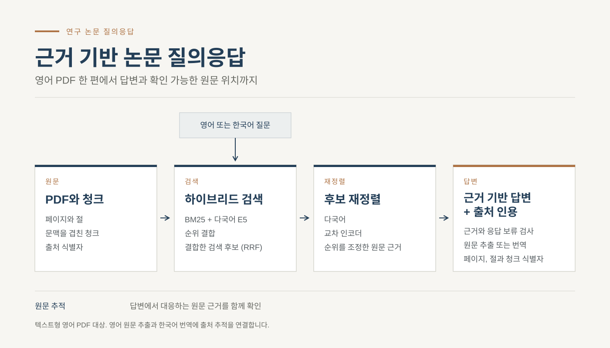
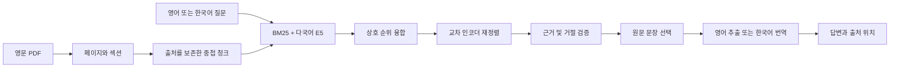

# Evidence-Grounded Paper Q&A

[English](README.md) | [한국어](README_KO.md)

영문 논문을 올리고 그 내용에 관해 질문하면, 관련 구절을 찾아 원문 문장이나 한국어 번역으로 답하고 인용한 위치를 함께 보여줍니다. 독자는 답변에 연결된 논문 원문을 열어 어떤 근거로 답했는지 직접 살펴볼 수 있습니다.



영문 연구 논문 한 편에서 근거를 검색하고 영어와 한국어 질문에 답하는 로컬 애플리케이션입니다. 하이브리드 검색, 교차 인코더 재정렬, 추출형 답변, 한국어 번역과 출처 추적을 FastAPI와 Streamlit 서비스로 연결했습니다.

논문 질의응답 시스템의 전체 구현과 재현 가능한 평가를 보여주는 프로젝트입니다. 현재 답변에는 요청한 내용의 누락, 전문 용어 오역과 근거가 부족한 질문에 대한 응답 문제가 남아 있으며, 공개한 측정 결과에서 이러한 한계를 확인할 수 있습니다.

이번 포트폴리오 버전은 연구 프로토타입으로 마무리했습니다. 개발 전략 세 개가 사전에 정한 채택 기준을 충족하지 못해 실험용 문맥 확대와 추가 재검색은 기본 설정에서 비활성화했습니다. 원문 대조 기능과 측정 자료는 유지합니다. [포트폴리오 설명](https://park-dongmyung.com/projects/project-01/), [최종 결과](docs/results_KO.md)와 [실험 판단](docs/experiments_KO.md)에서 범위를 확인할 수 있습니다.

## 데모

| 영어 답변과 근거 | 한국어 답변과 근거 |
| --- | --- |
|  |  |

추가 화면: [업로드](docs/assets/screenshots/01-upload.png), [논문 개요](docs/assets/screenshots/02-analysis-complete.png), [Docker 이미지](docs/assets/screenshots/docker.png). 화면 예시는 인터페이스를 설명하며 답변 정확성을 보증하지 않습니다.

실제 실행 화면은 영문 UI를 그대로 보존했습니다. 한국어 예시는 한국어 질문과 번역 답변을 영어 논문의 원문 근거와 함께 보여주며, 화면의 언어를 편집한 이미지가 아닙니다.

## 각 기술이 연결되는 방식

먼저 근거 후보를 검색한 뒤 답변에 사용할 문장을 고르고, 반환할 수 있는지 검사합니다. 검사에서 근거가 부족하다고 판단하면 답변을 거절할 수 있지만, 현재 검사가 모든 근거 부족 질문을 정확히 구분하지는 못합니다.

| 아래에 등장하는 용어 | 이 프로젝트에서의 의미 |
| --- | --- |
| 청크 | 논문을 일부 겹치도록 나눈 짧은 텍스트 조각입니다. 페이지와 섹션을 보존해 검색한 구절을 PDF 원문에서 다시 찾을 수 있습니다. |
| BM25와 다국어 E5 | BM25는 단어의 일치를 중심으로 찾고, E5는 질문과 문단을 수치 벡터로 바꿔 언어가 달라도 의미의 유사성을 비교합니다. 두 방식을 함께 쓰는 것이 하이브리드 검색입니다. |
| 상호 순위 융합 | 서로 기준이 다른 검색 점수를 그대로 비교하는 대신, 각 검색 결과의 순위를 이용해 후보 목록을 합칩니다. |
| 교차 인코더 재정렬 | 질문과 후보 문단을 함께 읽는 모델로 후보의 관련성을 다시 판단해 순서를 조정합니다. |
| 추출형 답변과 NLLB | 영어 답변은 선택한 원문 문장으로 구성하고, 한국어 출력은 NLLB로 번역합니다. 기본 경로는 새로운 설명을 자유롭게 생성하지 않습니다. |
| FastAPI와 Streamlit | FastAPI는 분석 요청을 처리하고, Streamlit은 논문 업로드와 질문 및 근거 확인을 위한 브라우저 화면을 제공합니다. |

검색 품질, 답변의 완전성과 번역 품질은 각각 확인해야 합니다. 관련 페이지를 찾았더라도 요청한 세부 내용이 빠지거나 번역이 잘못될 수 있습니다.

## 구현한 내용

- 텍스트형 PDF에서 페이지와 섹션을 추출하고 출처 식별자를 보존한 중첩 청크를 생성했습니다.
- BM25와 다국어 E5 검색 결과를 상호 순위 융합으로 통합하고 다국어 교차 인코더로 재정렬했습니다.
- 선택한 원문 문장으로 영어 답변을 구성하고, 버전을 고정한 NLLB 모델과 용어 보호 및 수치 검증을 적용해 한국어로 번역했습니다.
- 명시적 전제와 요청 내용에 대한 제한적인 검증 및 답변 거절 정책을 적용하고, 인용에 원문과 페이지, 섹션 및 청크 식별자를 연결했습니다.
- FastAPI 업로드 및 분석 작업을 이중 언어 Streamlit 인터페이스와 연결하고 Docker Compose로 로컬 실행 환경을 구성했습니다.
- 이중 언어 의미 그룹을 평가 단위로 삼고 개발 논문과 평가 논문을 분리했으며, 실행 전 구현 동결과 해시 보존 및 초기 실행과 반복 실행의 단계별 시간 측정을 도입했습니다.
- 요청 항목 추적과 원문 문맥 복원을 구현하고 평가했습니다. 기본 서비스는 원문 대응을 제공하며, 채택 기준을 통과하지 못한 선택 기능은 비활성화했습니다.

## 구조



기본 실행 경로는 추출과 번역을 사용합니다. 생성 모델의 비교 실험은 [실험 기록](docs/experiments_KO.md)에 별도로 정리했습니다. 상세 구현은 [아키텍처](docs/architecture_KO.md)와 [답변 정책](docs/answer_policy_KO.md)을 참고할 수 있습니다.

## 측정 결과

아래 표는 시스템의 여러 동작을 나누어 검사한 결과입니다. **의미 그룹**은 같은 정보를 묻는 영어와 한국어 질문의 묶음이며, 그룹 단위 검사는 두 답변이 모두 조건을 충족해야 통과합니다. **DEV**는 변경안을 비교하는 개발 집합이고, 최종 비교는 구현을 고정한 뒤 수행합니다. **근거 부족 질문**은 논문이 제공하지 않는 정보를 묻는 질문이며, **잘못된 전제 질문**은 논문 내용에 관한 틀린 가정에서 출발하는 질문입니다. **어휘 표지**는 자동 완전성 검사에서 찾는 예상 표현이나 동의어입니다.

전체 논문 30편을 영어와 한국어로 묶은 의미 그룹 180개, 버전별 출력 360개로 평가했습니다. 개발에는 10편을 사용했고, 최종 비교에는 20편을 사용했습니다. 두 언어가 모두 조건을 만족해야 그룹 단위 통과로 인정합니다.

평가 논문 20편에는 답변 가능 80개, 근거 부족 20개, 잘못된 전제 20개 그룹이 있습니다.

두 열은 사전학습 검색 및 번역 모델을 활용해 직접 개발한 같은 시스템의 구현을 비교합니다. '초기 개발 버전'은 이번 개선 실험을 시작할 당시의 구현이며, '최종 개발 버전'은 실험 결과를 검토한 뒤 공개하기로 확정한 버전입니다.

| 검사 항목 | 초기 개발 버전 | 최종 개발 버전 |
| --- | ---: | ---: |
| 출력 형식 준수 | 240/240 | 240/240 |
| 답변 가능한 질문에 응답 | 50/80 | 49/80 |
| 필수 정보의 어휘 표지 모두 포함 | 11/80 | 11/80 |
| 정답 근거 위치 중 하나를 인용 | 32/80 | 31/80 |
| 근거가 없는 요청을 거절 | 18/20 | 18/20 |
| 잘못된 전제의 요청을 거절 | 2/20 | 2/20 |
| 의미상 정확도 | 독립 측정 없음 | 독립 측정 없음 |

어휘 표지 포함은 답변의 완전성을 살펴보는 자동 진단이며 정확도가 아닙니다. 응답 여부와 인용 위치도 사실 정확성을 보증하지 않습니다. 레이블은 AI 보조 원문 검토로 작성했으며 독립적인 사람의 사실 검증은 아직 수행하지 않았습니다. 정식 비교 전에 중단한 기존 및 후보 실행은 제외했습니다. 운영자 기록상 이 실행의 답변과 점수는 열람하거나 개선에 사용하지 않았으며, 진행 건수와 사례 ID는 확인했습니다. 최종 소스를 고정한 뒤 정식 비교를 수행했습니다. 이 이력은 [결과 문서](docs/results_KO.md)에 공개했습니다.

[평가 입력과 결과](data/benchmarks/corpus30/README_KO.md) 및 두 버전의 측정 당시 소스를 공개합니다. 이전 논문 4편 평가와 과거 검색 평가는 별도의 회귀 근거로 보존합니다.

## 로컬 실행

Docker Desktop을 설치하고 저장소 루트에서 실행합니다.

```bash
docker compose up --build -d
docker compose ps
```

- UI: `http://127.0.0.1:8501`
- API 문서: `http://127.0.0.1:8000/docs`
- 상태 확인: `http://127.0.0.1:8000/health`

첫 분석은 고정된 모델을 내려받느라 수 분 걸릴 수 있으며 UI는 최대 600초 기다립니다. 최대 20 MiB의 텍스트형 영문 PDF 한 편을 올린 뒤 영어 또는 한국어로 질문하고 인용 원문을 확인합니다.

```bash
docker compose down
```

명명된 볼륨에는 업로드 자료와 모델이 유지됩니다. 이 자료까지 삭제하려는 경우에만 `--volumes`를 추가합니다. 의존성, 모델 라이선스와 문제 해결 방법은 [Docker 안내](docs/deployment/docker_KO.md)에 있습니다. 기본 한국어 번역 모델에는 비상업적 이용 라이선스가 적용됩니다.

## 검증과 재현

Python 3.12에서 모델 다운로드나 비공개 PDF 없이 공개 산출물을 검사할 수 있습니다.

```bash
python -m pip install -r requirements-test.txt
python -B scripts/verify_project.py
```

실제 모델 평가에는 `requirements.txt`가 필요합니다. [평가 결과](docs/results_KO.md), [스크립트 안내](scripts/README_KO.md)와 [외부 검증 절차](docs/third_party_review_KO.md)에서 명령과 검증 범위를 설명합니다. 회귀 테스트 382개를 통과했고, 별도 Linux 환경에서 미리 선정한 출력 12개의 답변과 원문 대응 및 인용 출처가 일치했습니다. 전체 논문 30편의 임베딩을 새로 생성했습니다. [재현 기록](data/benchmarks/corpus30/results/reproduction/README_KO.md)은 에이전트가 같은 물리 호스트의 다른 운영체제 환경에서 수행한 표본 검증이며, 독립적인 사람의 사실 검토는 아직 수행하지 않았습니다.

고정한 산출물과 과거 원본은 `.gitattributes`로 바이트를 보존합니다. 변경하면 기록된 해시와 일치하지 않습니다. 공개 검증은 원본 PDF 30편과 검색 캐시가 없으면 비공개 코퍼스 검사를 건너뜁니다.

## 저장소 구성

```text
app/       API, 분석 작업, 저장소와 질의응답 서비스
ui/        이중 언어 Streamlit 인터페이스
config/    모델 버전과 실행 정책
scripts/   수집, 평가와 검증 명령
tests/     회귀 및 산출물 무결성 테스트
data/      이용 허가된 자료, 최종 측정 결과와 당시 구현 원본
docs/      영어 기본 문서와 한국어 문서
```

일차별 작업 기록, 개인 메모, 임시 출력, 업로드 PDF와 모델 캐시는 공개 대상에서 제외했습니다. 채택과 중단 판단에 필요한 고정 실험 근거는 공개합니다. 최종 평가 근거는 다른 사용자가 확인할 수 있도록 공개하며, Git 추적 파일과 추가 가능한 파일을 기준으로 공개 범위를 검사합니다.

## 지원 범위와 문서

텍스트형 영문 PDF를 지원합니다. OCR, 표와 그림의 시각적 추론, 신뢰할 수 있는 수식 해석, 여러 논문 비교, 계정과 공개 배포는 현재 구현 범위에 포함되지 않습니다. 인용은 검토 가능한 근거이며 과학적 정확성을 보증하지 않습니다.

- [문서 목차](docs/README_KO.md)
- [현재 평가 결과와 실패 분석](docs/results_KO.md)
- [범위를 제한한 모델 비교 실험](docs/experiments_KO.md)
- [아키텍처](docs/architecture_KO.md)
- [품질 평가](docs/quality_benchmark_KO.md)
- [과거 실패 사례](docs/failure_cases_KO.md)
- [데이터와 라이선스](docs/data_KO.md)
