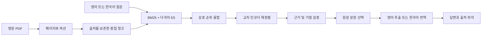

# Evidence-Grounded Paper Q&A

[English](README.md) | [한국어](README_KO.md)

영문 연구 논문 한 편에서 근거를 검색하고 영어와 한국어 질문에 답하는 로컬 애플리케이션입니다. 하이브리드 검색, 교차 인코더 재정렬, 추출형 답변, 한국어 번역과 출처 추적을 FastAPI와 Streamlit 서비스로 연결했습니다.

논문 질의응답 시스템의 전체 구현과 재현 가능한 평가를 보여주는 프로젝트입니다. 현재 답변에는 요청한 내용의 누락, 전문 용어 오역과 근거가 부족한 질문에 대한 응답 문제가 남아 있으며, 공개한 측정 결과에서 이러한 한계를 확인할 수 있습니다.

## 데모

| 영어 답변과 근거 | 한국어 답변과 근거 |
| --- | --- |
|  |  |

추가 화면: [업로드](docs/assets/screenshots/01-upload.png), [논문 개요](docs/assets/screenshots/02-analysis-complete.png), [Docker 이미지](docs/assets/screenshots/docker.png). 화면 예시는 인터페이스를 설명하며 답변 정확성을 보증하지 않습니다.

## 구현한 내용

- 텍스트형 PDF에서 페이지와 섹션을 추출하고 출처 식별자를 보존한 중첩 청크를 생성했습니다.
- BM25와 다국어 E5 검색 결과를 상호 순위 융합으로 통합하고 다국어 교차 인코더로 재정렬했습니다.
- 선택한 원문 문장으로 영어 답변을 구성하고, 버전을 고정한 NLLB 모델과 용어 보호 및 수치 검증을 적용해 한국어로 번역했습니다.
- 명시적 전제와 요청 내용에 대한 제한적인 검증 및 답변 거절 정책을 적용하고, 인용에 원문과 페이지, 섹션 및 청크 식별자를 연결했습니다.
- FastAPI 업로드 및 분석 작업을 이중 언어 Streamlit 인터페이스와 연결하고 Docker Compose로 로컬 실행 환경을 구성했습니다.
- 이중 언어 의미 그룹을 평가 단위로 삼고 개발 논문과 평가 논문을 분리했으며, 실행 전 구현 동결과 해시 보존 및 초기 실행과 반복 실행의 단계별 시간 측정을 도입했습니다.

## 구조



기본 실행 경로는 추출과 번역을 사용합니다. 생성 모델의 비교 실험은 [실험 기록](docs/experiments_KO.md)에 별도로 정리했습니다. 상세 구현은 [아키텍처](docs/architecture_KO.md)와 [답변 정책](docs/answer_policy_KO.md)을 참고할 수 있습니다.

## 측정 결과

현재 구현을 고정한 실논문 평가의 범위는 평가 논문 2편, 이중 언어 의미 그룹 16개와 출력 32개입니다. 의미 그룹 단위의 통과는 두 언어 모두 해당 조건을 만족해야 인정합니다.

| 검사 항목 | 현재 고정 구현의 결과 |
| --- | ---: |
| 출력 형식 준수 | 출력 32/32개 |
| 답변 가능한 질문에 응답 | 그룹 7/10개 |
| 근거가 부족한 질문을 거절 | 그룹 1/4개 |
| 잘못된 전제의 질문을 거절 | 그룹 0/2개 |
| 필요한 원문 페이지를 모두 인용 | 답변 가능 그룹 5/10개 |
| 의미상 답변 정확도 | 독립적으로 측정하지 않음 |

답변을 반환하거나 예상 페이지를 인용했다는 사실만으로 정확성을 판단할 수 없습니다. 이 결과로 운영 수준의 신뢰성을 주장할 수 없으며, 공개 이후 같은 평가 자료를 활용한 개선에서는 해당 자료를 회귀 검증용으로 취급해야 합니다. 원출력, 측정 범위, 지연시간과 재현 명령은 [평가 결과와 실패 분석](docs/results_KO.md)에 정리했습니다.

별도의 [과거 검색 평가](docs/evaluation_KO.md)는 논문 10편의 질문 40개에서 Recall@3 0.850, Recall@5 1.000과 MRR 0.5838을 기록했습니다. 이 수치는 보존한 당시 구현의 결과이며 현재 답변 정확도를 뜻하지 않습니다.

## 로컬 실행

Docker Desktop을 설치하고 저장소 루트에서 실행합니다.

```bash
docker compose up --build -d
docker compose ps
```

- UI: `http://127.0.0.1:8501`
- API 문서: `http://127.0.0.1:8000/docs`
- 상태 확인: `http://127.0.0.1:8000/health`

첫 분석은 고정된 모델을 내려받느라 수 분 걸릴 수 있으며 UI는 최대 600초 기다립니다. 최대 20 MiB의 텍스트형 영문 PDF 한 편을 올린 뒤 영어 또는 한국어로 질문하고 인용 원문을 확인합니다.

```bash
docker compose down
```

명명된 볼륨에는 업로드 자료와 모델이 유지됩니다. 이 자료까지 삭제하려는 경우에만 `--volumes`를 추가합니다. 의존성, 모델 라이선스와 문제 해결 방법은 [Docker 안내](docs/deployment/docker_KO.md)에 있습니다. 기본 한국어 번역 모델에는 비상업적 이용 라이선스가 적용됩니다.

## 검증과 재현

Python 3.12에서 모델 다운로드나 비공개 PDF 없이 공개 산출물을 검사할 수 있습니다.

```bash
python -m pip install -r requirements-test.txt
python -B scripts/verify_project.py
```

실제 모델 평가에는 `requirements.txt`가 필요합니다. [평가 결과](docs/results_KO.md), [스크립트 안내](scripts/README_KO.md)와 [외부 검증 절차](docs/third_party_review_KO.md)에서 명령과 검증 범위를 설명합니다. 새 Linux 환경에서는 기존 평가 출력 32개와 HTTP 사례 7개가 재현됐습니다. 이는 에이전트가 수행한 환경 재현이며, 독립적인 사람의 사실 검토는 아직 수행하지 않았습니다.

고정한 산출물과 과거 원본은 `.gitattributes`로 바이트를 보존합니다. 변경하면 기록된 해시와 일치하지 않습니다. 공개 검증은 원본 PDF 30편과 검색 캐시가 없으면 비공개 코퍼스 검사를 건너뜁니다.

## 저장소 구성

```text
app/       API, 분석 작업, 저장소와 질의응답 서비스
ui/        이중 언어 Streamlit 인터페이스
config/    모델 버전과 실행 정책
scripts/   수집, 평가와 검증 명령
tests/     회귀 및 산출물 무결성 테스트
data/      이용 허가된 자료, 최종 측정 결과와 당시 구현 원본
docs/      영어 기본 문서와 한국어 문서
```

작업 일지, 개인 메모, 중간 실험, 업로드 PDF와 모델 캐시는 공개 대상에서 제외했습니다. 최종 평가 근거는 다른 사용자가 확인할 수 있도록 공개하며, Git 추적 파일과 추가 가능한 파일을 기준으로 공개 범위를 검사합니다.

## 지원 범위와 문서

텍스트형 영문 PDF를 지원합니다. OCR, 표와 그림의 시각적 추론, 신뢰할 수 있는 수식 해석, 여러 논문 비교, 계정과 공개 배포는 현재 구현 범위에 포함되지 않습니다. 인용은 검토 가능한 근거이며 과학적 정확성을 보증하지 않습니다.

- [문서 목차](docs/README_KO.md)
- [현재 평가 결과와 실패 분석](docs/results_KO.md)
- [범위를 제한한 모델 비교 실험](docs/experiments_KO.md)
- [아키텍처](docs/architecture_KO.md)
- [품질 평가](docs/quality_benchmark_KO.md)
- [과거 실패 사례](docs/failure_cases_KO.md)
- [데이터와 라이선스](docs/data_KO.md)
