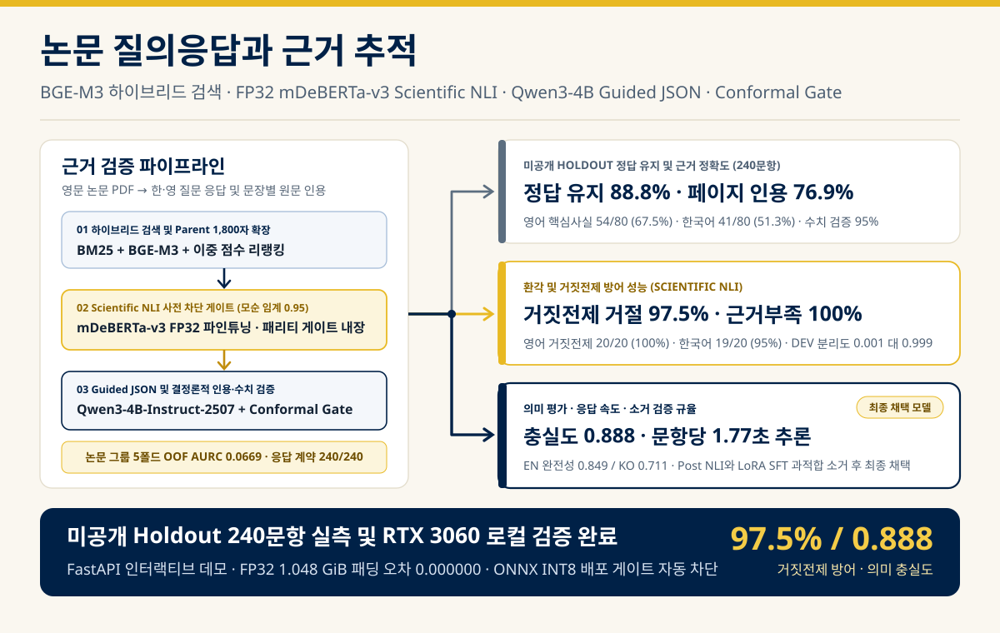
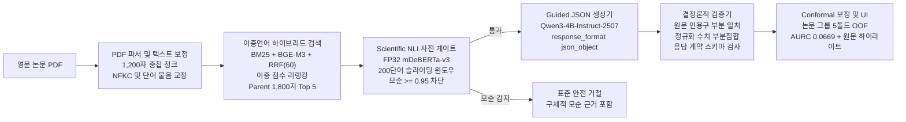

# 시스템 아키텍처

> **언어**: [English](architecture.md) | **한국어 (Korean)**

  

## 1. 근거 검증 파이프라인 전체 흐름

영문 논문 PDF에 대한 모든 한국어·영어 질문은 [`paper_qna/`](../paper_qna/) 패키지에 구현된 5단계 파이프라인을 거쳐 검증됩니다.

## 2. 모듈별 책임과 구현

| 모듈 | 파일 | 역할 |
| --- | --- | --- |
| PDF 파서 및 텍스트 보정 | [`paper_qna/pdf_parser.py`](../paper_qna/pdf_parser.py) | 업로드된 텍스트형 PDF 또는 `corpus30`에서 페이지·섹션 정보를 보존한 `1,200`자 중첩 청크(`200`자 중첩)를 생성하고, NFKC 정규화·소프트 하이픈 제거·단어 붙음 오류를 결정론적으로 교정합니다. |
| 이중언어 하이브리드 검색기 | [`paper_qna/retrieval.py`](../paper_qna/retrieval.py) | 무의존 `SimpleBM25`와 선택적 `BAAI/bge-m3` 밀집 검색을 `RRF(k=60)`로 결합합니다. 한국어 질문은 영문 학술 검색어로 병렬 번역해 `BAAI/bge-reranker-v2-m3` 이중 점수 리랭킹(`0.65 EN + 0.35 KO`)을 수행한 뒤, 상위 `5`개 청크(페이지당 최대 `2`개)를 동일 페이지 내 `1,800`자 Parent Window로 확장합니다. |
| Scientific NLI 및 Conformal Gate | [`paper_qna/nli_gate.py`](../paper_qna/nli_gate.py) | 질문의 명시적 전제절(`Since ...`, `...입증했으므로`)을 추출하고, 검색 근거를 `200`단어(`stride 120`) 창으로 분할해 엄격한 FP32 PyTorch `mDeBERTa-v3`로 모순 확률을 산출합니다. 패딩 불변성 검증 게이트가 손상된 ONNX INT8 그래프를 자동 차단하며, 무피클 JSON 기반 `ConformalGate`가 논문 그룹 5폴드 OOF 위험 커버리지 확률을 계산합니다. |
| Guided JSON 검증기 | [`paper_qna/verifier.py`](../paper_qna/verifier.py) | 이중언어 전제 확인 프롬프트를 구성하고 `<think>` 블록 및 코드 펜스를 제거해 JSON을 파싱합니다. 각 주장의 `verbatim_quote` 일치(정확한 부분 문자열 또는 영숫자 토큰 `72%` 이상 겹침)와 정규화 수치 부분집합 일치를 검사한 뒤 응답 계약 불변식을 검증합니다. |
| 로컬 LLM 클라이언트 | [`paper_qna/llm_client.py`](../paper_qna/llm_client.py) | 표준 라이브러리 기반 HTTP 클라이언트로 로컬 OpenAI 호환 서버(`llama-server`, Ollama, vLLM)의 `Qwen/Qwen3-4B-Instruct-2507`과 통신하며, `response_format` 자동 폴백과 한국어 영문 검색 번역 기능을 제공합니다. |
| 통합 엔진 및 웹 데모 | [`paper_qna/pipeline.py`](../paper_qna/pipeline.py), [`paper_qna/web_demo.py`](../paper_qna/web_demo.py) | 스레드 안전한 `PaperQnAEngine` 위에서 FastAPI(미설치 시 stdlib HTTP 자동 폴백) REST API(`/health`, `/api/status`, `/api/papers`, `/api/presets`, `/api/upload`, `/api/ask`, `/api/nli-check`), 이중언어 웹 UI([`paper_qna/static/index.html`](../paper_qna/static/index.html)), CLI([`paper_qna/cli.py`](../paper_qna/cli.py))를 제공합니다. |

## 3. 응답 계약 불변식 (Response Contract)

`PaperQnAEngine.ask()`가 반환하는 모든 응답은 `validate_answer_payload()`에서 다음 4가지 불변식을 강제합니다.

1. `sufficiency`는 반드시 `"sufficient"` 또는 `"insufficient"` 중 하나입니다.
2. `"insufficient"`인 경우 `evidence_ids`와 `cited_evidence`는 반드시 빈 배열(`[]`)이어야 하며, 질문 언어에 맞는 비어 있지 않은 `abstention_reason`을 포함해야 합니다.
3. `"sufficient"`인 경우 `evidence_ids`는 `1`개에서 `5`개 사이의 고유 ID를 가지며 `cited_evidence`와 정확히 일치해야 하고, `abstention_reason`은 `null`이어야 하며, 한국어 답변에는 반드시 한글이 포함되어야 합니다.
4. `answer_alignment`의 각 주장은 `evidence_id`, `page`, `section`, `verbatim_quote`, `quote_verified`, `numeric_verified`를 기록해 UI에서 원문 하이라이트와 직접 연결됩니다.

## 4. 런타임 안전 게이트 (패딩 불변성 자동 검사)

엔진 초기화 시 로컬 ONNX INT8 바이너리가 감지되면 `ScientificNLIOnnx.check_padding_invariance()`가 과학 모순 탐지 프로브 문장을 비패딩 입력과 `max_length=384` 제로 패딩 입력으로 각각 추론해 모순 확률 차이를 측정합니다. `abs_diff > 0.02`이면 상대 위치 어텐션 손상으로 판정해 해당 ONNX 경로를 자동 차단(`onnx_int8_blocked_by_parity_gate`)하고 검증된 FP32 경로로 보호합니다.
