# 아키텍처 · Evidence-Grounded Paper Q&A v2

[English](architecture.md) · [README](../README.ko.md) · [방법론 및 설계 의사결정](methodology-and-decisions.ko.md) · [결과](results.ko.md) · [재현 및 데모](reproduction.ko.md)

## 시스템 개요

Evidence-Grounded Paper Q&A v2는 일반 소비자용 **6 GB VRAM GPU / CPU 환경**에서 실행되도록 설계된 이중언어(영어·한국어) 과학 논문 질의응답 시스템입니다. 모든 답변에 대해 **출처 추적**, **거짓전제(False Premise) 차단**, **원문 인용·수치의 결정론적 검증**을 강제합니다.

```mermaid
flowchart LR
    PDF["영문 논문 PDF (<= 20 MiB)"] --> Parse["페이지·절 청킹 + 결정론적 텍스트 보정"]
    Parse --> Chunks["중첩 청크 (1,200자, 200자 중첩)"]
    Q["한국어 또는 영어 질문"] --> Tr["한국어 -> 영문 검색 질의 변환"]
    Tr --> Ret["BM25 + BGE-M3 밀집 검색 + RRF (k=60)"]
    Chunks --> Ret
    Ret --> Rerank["Dual-Score 교차 인코더 재정렬 (bge-reranker-v2-m3: 0.65 EN + 0.35 KO)"]
    Rerank --> Parent["Parent 문맥 확장 (최대 1,800자, 페이지당 <=2개, Top-5)"]
    Parent --> NLI["슬라이딩 윈도우 Scientific NLI 사전 게이트 (FP32 -> ONNX INT8, thr=0.95)"]
    NLI -- "contra >= 0.95 & contra > entail" --> Refuse["표준 거절 응답 (거짓전제 선제 차단)"]
    NLI -- "통과" --> LLM["Qwen3-4B-Instruct-2507 (Guided JSON response_format)"]
    LLM --> Verify["결정론적 검증기 (응답 계약 + 원문 인용구 + 수치 무결성)"]
    Verify --> Gate["논문 그룹 5-Fold OOF Conformal Gate (AURC 0.0669)"]
    Gate --> Out["근거 기반 EN/KO 답변 + 문장별 인용 + 원문 하이라이트"]
```

---

## 핵심 모듈 명세

### 1. PDF 수집 및 결정론적 텍스트 보정 (`paper_qna/pdf_parser.py`, `paper_qna/verifier.py`)
- **청킹**: 텍스트형 영문 PDF에서 페이지·절 경계를 유지하며 `1,200`자 크기(`200`자 중첩)의 추적 가능한 청크를 생성합니다.
- **텍스트 보정**: NFKC 정규화, 소프트 하이픈(`\u00ad`)·제로폭 공백 제거, PDF 추출 시 자주 발생하는 단어 붙음 오류(`thisalgorithm -> this algorithm`)를 결정론적으로 교정합니다.

### 2. 이중언어 하이브리드 검색 및 Parent 문맥 확장 (`paper_qna/retrieval.py`)
- **이중 관점 검색**: 원질문과 한국어 질문의 영문 검색 번역문을 함께 사용해 **BM25**와 **`BAAI/bge-m3`** 밀집 검색을 결합하고 **RRF(`k=60`)**로 상위 25개 후보를 추출합니다.
- **Dual-Score 교차 인코더 재정렬**: **`BAAI/bge-reranker-v2-m3`**(`max_length=1024`)로 영문 번역 점수(`0.65`)와 한국어 원질문 점수(`0.35`)를 가중 결합해 교차언어 순위 붕괴를 방지합니다.
- **Parent Window (`1,800`자)**: 페이지당 최대 2개로 다양화해 Top-5를 선택한 뒤, 동일 페이지의 인접 청크를 최대 `1,800`자까지 병합해 목록·수치·조건절 절단을 해소합니다.

### 3. 슬라이딩 윈도우 Scientific NLI 사전 게이트 (`paper_qna/nli_gate.py`)
- **백본 및 학습**: `MoritzLaurer/mDeBERTa-v3-base-mnli-xnli`를 `corpus30`과 0% 겹치는 외부 arXiv 논문 150편 + SciFact 기반 `7,729`개 균형 EN/KO 데이터셋으로 **FP32 전체 미세조정**(`bf16=False, fp16=False`, `Val Loss = 0.1676`)했습니다.
- **슬라이딩 윈도우 · 전제절 추출**: `1,800`자 Parent 본문을 `200`단어 창(`stride=120`)으로 나누고, 질문 속 내포 전제절(`"Since the paper establishes that ..."`, `"논문이 ... 입증했으므로"`)을 별도 가설로 추출해 검사합니다.
- **차단 규칙 (`nli_contra_threshold = 0.95`, `post_nli = None`)**: `max_contra >= 0.95`이면서 `max_contra > max_entail`인 경우 LLM 호출 전에 즉시 거짓전제로 차단합니다.
- **엣지 배포**: 동적 양자화 **ONNX INT8 (`322.7 MiB`)**로 내보내 PyTorch 없이 `onnxruntime` CPU만으로 실시간 실행됩니다.

### 4. Guided JSON 생성 및 결정론적 검증기 (`paper_qna/llm_client.py`, `paper_qna/verifier.py`)
- **생성기**: 순정 **`Qwen/Qwen3-4B-Instruct-2507`**에 Guided JSON(`response_format: {"type": "json_object"}`, `max_tokens=1024`, `temperature=0.0`)을 강제해 `{premise_check, premise_reason, claims}` 구조를 출력합니다.
- **결정론적 검증 4단계**: ① 유효 `evidence_id` 대조 → ② 원문 인용구(`verbatim_quote`) 부분일치 / 토큰 중첩 `>= 0.72` 검증 → ③ 부호·콤마·지수 표기를 정규화한 수치 무결성 검증 → ④ 응답 계약 검증(충분 시 1~5개 인용 및 한국어 한글 포함, 불충분 시 인용 0개 및 사유 명시).

### 5. 논문 그룹 5-Fold OOF Conformal Gate (`reports/calibrated_gate.json`)
- DEV 10편(`120`출력)에서 `paper_id` 단위 **`GroupKFold(5)`**로 누수 없이 OOF 확률을 추정한 뒤, `alpha ∈ {0.02, 0.05, 0.10}`별 분할 Conformal 임계값을 산출합니다(**OOF AURC = `0.0669`**). 순수 JSON 파라미터로 저장해 `pickle` 의존성을 제거했습니다.

### 6. 로컬 인터랙티브 웹 데모 및 API (`paper_qna/web_demo.py`, `paper_qna/static/index.html`)
- FastAPI + Uvicorn 기반 웹 UI와 REST API(`/`, `/health`, `/api/status`, `/api/papers`, `/api/presets`, `/api/upload`, `/api/ask`, `/api/nli-check`, `/docs`)를 제공하며, FastAPI 미설치 환경에서도 표준 라이브러리 `ThreadingHTTPServer`로 자동 폴백합니다.
