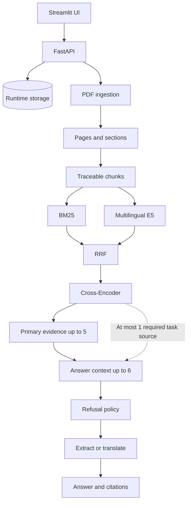

# Architecture

The user supplies a paper and a question; the output is selected source text, optional Korean translation and traceable citations. Read the diagram as three stages: prepare searchable text, find and check evidence, then return an answer with its source. Chunks are overlapping text pieces, embeddings are numerical representations used for meaning-based search, and reranking revisits the shortlist with a question-and-passage model. The implementation details below explain how these stages connect.

[English](architecture.md) | [한국어](architecture_KO.md)

## Request flow

1. The FastAPI backend validates and stores one text-based English PDF.
2. The ingestion pipeline extracts page text, detects sections, and creates chunks that preserve `paper_id`, page, section, and `chunk_id`.
3. BM25 and multilingual E5 independently retrieve candidates from the selected paper.
4. Reciprocal rank fusion combines both rankings. A Cross-Encoder reranks the 20-candidate pool.
5. The evidence selector returns up to five primary, traceable passages with their ranks and scores.
6. A deterministic relevance policy may refuse the question before generation.
7. English answers are composed extractively. Korean answers translate selected evidence with the pinned local NLLB model.
8. At most five citations are assembled from validated source evidence, not invented by the answer model.

The evidence-first path also checks observable question premises and requested
aspects before translation inference. Question-specific context budgets preserve
lists and adjacent qualifications. See [answer policy](answer_policy.md) for
the current processing rules and conservative validation limits.

For an explicit prediction-task request, answer context may include one additional
full chunk containing the required plain prose from the same paper's existing
reranked 20-candidate pool. This leaves the primary evidence objects, ranks and
scores intact and raises the answer-context limit to six. No new source is
fetched; if the required task support is unavailable, the answer is refused.

`evidence_selection.answer_context_supplements` and
`evidence_selection.answer_context_supplement_origins` disclose the extra source.
`pipeline.evidence_context` records `primary_retrieval_count`,
`primary_retrieval_evidence_ids`, `supplement_count`, `answer_context_count` and
`supplement_origins`. The pipeline output's `retrieved_evidence` contains the full
answer context; `cited_evidence` contains only citations that passed validation.
The HTTP `/question` response exposes those actual citations as `evidence`.

## Why this design

- Sparse retrieval remains strong for exact English terminology.
- Multilingual dense retrieval reduces vocabulary mismatch for Korean questions over English papers.
- Reranking improves ordering after broad candidate recall.
- Page and chunk identifiers remain attached throughout the pipeline, making each citation auditable.
- Generation cannot choose arbitrary citation identifiers; the service attaches citations from the selected source sentences.

## Runtime boundary

The application processes one uploaded paper at a time. Runtime uploads and per-paper indexes are private and excluded from Git. The portfolio corpus is used for evaluation and is not copied into Docker images. Models are pretrained and revision-pinned; this project does not fine-tune them.
