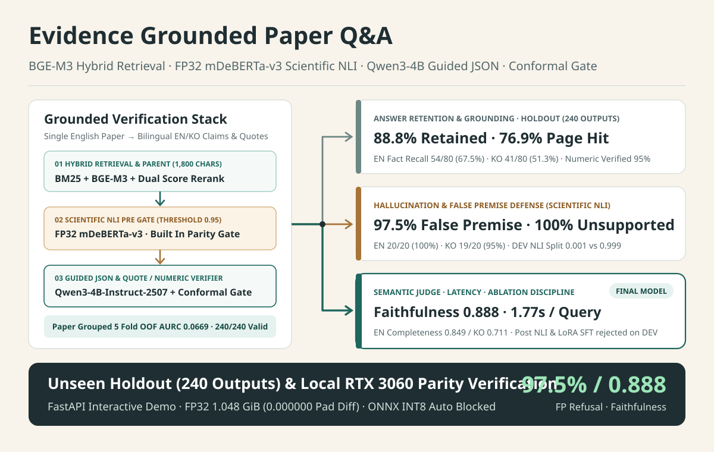
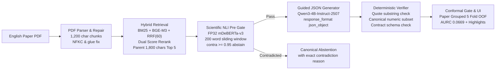

# System Architecture

> **Language**: **English** | [한국어 (Korean)](architecture.ko.md)

  

## 1. End to End Verification Pipeline

Every user query against a target English PDF flows through five deterministic and neural stages implemented in [`paper_qna/`](../paper_qna/):

## 2. Module Breakdown

| Module | File | Responsibility |
| --- | --- | --- |
| PDF Parser & Repair | [`paper_qna/pdf_parser.py`](../paper_qna/pdf_parser.py) | Extracts page and section aware overlapping `1,200` char chunks (`200` overlap) from uploaded text based PDFs or `corpus30`, applying deterministic NFKC normalization, soft hyphen stripping, and word glue repair. |
| Bilingual Hybrid Retriever | [`paper_qna/retrieval.py`](../paper_qna/retrieval.py) | Combines dependency free `SimpleBM25` and optional `BAAI/bge-m3` dense retrieval via `RRF(k=60)`. For Korean questions, executes parallel English translated query search and applies Dual Score `BAAI/bge-reranker-v2-m3` (`0.65 EN + 0.35 KO`). Expands top `5` chunks (`max 2` per page) to `1,800` char same page Parent Windows. |
| Scientific NLI & Conformal Gate | [`paper_qna/nli_gate.py`](../paper_qna/nli_gate.py) | Extracts explicit premise clauses (`Since ...`, `...입증했으므로`), slices retrieved passages into `200` word windows (`stride 120`), scores contradiction probability with strict FP32 PyTorch `mDeBERTa-v3` (with built in padding invariance check blocking degraded ONNX INT8 graphs), and evaluates the zero pickle Paper Grouped 5 Fold OOF `ConformalGate`. |
| Guided JSON Verifier | [`paper_qna/verifier.py`](../paper_qna/verifier.py) | Builds the bilingual premise aware system prompt, enforces JSON extraction (stripping `<think>` blocks and fences), verifies verbatim quotes (`exact substring` or `>= 72%` alphanumeric overlap), checks canonical floating point numeric subset fidelity against retrieved passages, and enforces the strict response contract (`sufficient` with `1..5` evidence IDs or `insufficient` with empty citations and a non empty reason). |
| Local LLM Client | [`paper_qna/llm_client.py`](../paper_qna/llm_client.py) | Zero external dependency HTTP client connecting to any local OpenAI compatible server (`llama-server`, Ollama, vLLM) serving `Qwen/Qwen3-4B-Instruct-2507` with automatic `response_format` fallback and Korean to English search query translation. |
| Unified Engine & Web Demo | [`paper_qna/pipeline.py`](../paper_qna/pipeline.py), [`paper_qna/web_demo.py`](../paper_qna/web_demo.py) | Thread safe `PaperQnAEngine` serving FastAPI (with stdlib HTTP fallback), interactive bilingual UI ([`paper_qna/static/index.html`](../paper_qna/static/index.html)), REST API (`/health`, `/api/status`, `/api/papers`, `/api/presets`, `/api/upload`, `/api/ask`, `/api/nli-check`), and CLI ([`paper_qna/cli.py`](../paper_qna/cli.py)). |

## 3. Response Contract Schema

Every response returned by `PaperQnAEngine.ask()` satisfies four invariants validated by `validate_answer_payload()`:

1. `sufficiency` is strictly `"sufficient"` or `"insufficient"`.
2. If `"insufficient"`, `evidence_ids` and `cited_evidence` MUST be empty (`[]`), and `abstention_reason` MUST be a non empty explanation in the question language.
3. If `"sufficient"`, `evidence_ids` MUST contain `1` to `5` unique IDs matching `cited_evidence`, `abstention_reason` MUST be `null`, and Korean responses MUST contain Hangul characters.
4. Every claim in `answer_alignment` tracks `evidence_id`, `page`, `section`, `verbatim_quote`, `quote_verified`, and `numeric_verified`, enabling direct source highlighting in the UI.

## 4. Runtime Safety Gate (Padding Invariance Check)

Before enabling an exported ONNX INT8 NLI binary at startup, `PaperQnAEngine.__init__()` executes `ScientificNLIOnnx.check_padding_invariance()` on a fixed scientific contradiction probe comparing unpadded input against `max_length=384` zero padded input. If `abs_diff > 0.02`, the ONNX runtime is automatically blocked (`onnx_int8_blocked_by_parity_gate`) so degraded relative position attention graphs cannot silently corrupt live false premise gating.
