# Architecture · Evidence-Grounded Paper Q&A v2

[한국어](architecture.ko.md) · [README](../README.md) · [Methodology & Decisions](methodology-and-decisions.md) · [Results](results.md) · [Reproduction & Demo](reproduction.md)

## System Overview

Evidence-Grounded Paper Q&A v2 is a local bilingual (English & Korean) scientific paper question-answering system that enforces **source traceability**, **false-premise defense**, and **deterministic claim verification** within a consumer 6 GB GPU / CPU deployment budget.

```mermaid
flowchart LR
    PDF["English Paper PDF (<= 20 MiB)"] --> Parse["Page/Section Chunker + Deterministic Text Repair"]
    Parse --> Chunks["Overlapping Chunks (1,200 chars, 200 overlap)"]
    Q["EN or KO Question"] --> Tr["KO -> EN Query Translation (when KO)"]
    Tr --> Ret["BM25 + BGE-M3 Dense + RRF (k=60)"]
    Chunks --> Ret
    Ret --> Rerank["Dual-Score Cross-Encoder Rerank (bge-reranker-v2-m3: 0.65 EN + 0.35 KO)"]
    Rerank --> Parent["Parent Window Expansion (max 1,800 chars, <= 2/page, Top-5)"]
    Parent --> NLI["Sliding-Window Scientific NLI Pre-Gate (FP32 -> ONNX INT8, thr=0.95)"]
    NLI -- "contra >= 0.95 & contra > entail" --> Refuse["Canonical Abstention (False Premise Blocked)"]
    NLI -- "pass" --> LLM["Qwen3-4B-Instruct-2507 (Guided JSON response_format)"]
    LLM --> Verify["Deterministic Verifier (Contract + Verbatim Quote + Canonical Numbers)"]
    Verify --> Gate["Paper-Grouped 5-Fold OOF Conformal Gate (AURC 0.0669)"]
    Gate --> Out["Grounded EN/KO Answer + Inline Claims + Highlighted Source Passages"]
```

---

## Component Specifications

### 1. Ingestion & Deterministic PDF Text Repair (`paper_qna/pdf_parser.py`, `paper_qna/verifier.py`)
- **Chunking**: Page- and section-aware overlapping windows (`chunk_size=1200`, `overlap=200`) retaining exact `(paper_id, chunk_id, page, section)` metadata.
- **Deterministic PDF repair**: Applies Unicode NFKC normalization, strips soft hyphens (`\u00ad`) and zero-width spaces (`\u200b`), and repairs common PDF extraction word-glue artifacts (e.g., `thisalgorithm -> this algorithm`) before indexing and evaluation.

### 2. Bilingual Hybrid Retrieval & Parent Context (`paper_qna/retrieval.py`)
- **Two-view retrieval**: Combines lexical **BM25** and multilingual dense retrieval (**`BAAI/bge-m3`**) over both the original question and (for Korean queries) its concise English search translation, fused via **Reciprocal Rank Fusion (`rrf_k=60`)** into a 25-chunk shortlist.
- **Dual-Score Cross-Encoder Reranking**: Reranks the 25 candidates with **`BAAI/bge-reranker-v2-m3`** (`max_length=1024`), blending English and Korean query relevance (`0.65 * score_en + 0.35 * score_ko`) for Korean questions to prevent cross-lingual ranking collapse.
- **Page-diversified Parent Window (`1,800` chars)**: Selects Top-5 passages with at most 2 chunks per page, then expands each selected chunk with same-page adjacent context up to `1,800` characters so multi-sentence tables, parameter lists, and caveats stay intact.

### 3. Sliding-Window Scientific NLI Pre-Gate (`paper_qna/nli_gate.py`)
- **Backbone**: `MoritzLaurer/mDeBERTa-v3-base-mnli-xnli` full-parameter fine-tuned in **FP32** (`bf16=False, fp16=False`, `warmup_steps=100`, `max_grad_norm=1.0`) on `7,729` balanced EN/KO scientific entailment/neutral/contradiction pairs synthesized from `150` zero-overlap external arXiv papers + SciFact (`Val Loss = 0.1676` on paper-heldout validation).
- **Sliding-Window & Premise Clause Extraction**: Splits long `1,800`-char parent passages into `200`-word windows (`stride=120`) and extracts embedded EN/KO premise clauses (e.g., `"Since the paper establishes that ..."`, `"논문이 ... 입증했으므로"`).
- **Decision Rule (`nli_contra_threshold = 0.95`, `post_nli = None`)**: Blocks the request before LLM generation whenever `max_contra >= 0.95` and `max_contra > max_entail`.
- **Edge Deployment**: Exported to **ONNX INT8 (`322.7 MiB`)** using dynamic quantization for zero-PyTorch CPU execution via `onnxruntime`.

### 4. Guided JSON Generation & Deterministic Verifier (`paper_qna/llm_client.py`, `paper_qna/verifier.py`)
- **Generator**: Base **`Qwen/Qwen3-4B-Instruct-2507`** served with Guided JSON (`response_format: {"type": "json_object"}`, `max_tokens=1024`, `temperature=0.0`, non-thinking mode), emitting structured JSON `{premise_check, premise_reason, claims: [{text, evidence_id, verbatim_quote}]}`.
- **Deterministic Verifier**:
  1. **Evidence ID binding**: Drops any claim referencing a non-existent `evidence_id`.
  2. **Verbatim Quote check**: Verifies each `verbatim_quote` against its cited chunk via normalized exact substring match or `>= 0.72` alphanumeric token overlap.
  3. **Canonical Numeric Fidelity check**: Normalizes signs (`−`/`–`/`-`), commas, decimals, and scientific notation to confirm every number in a claim appears in the cited evidence.
  4. **Strict Response Contract**: Enforces `sufficiency in {"sufficient", "insufficient"}`, `1..5` valid citations when sufficient, `0` citations + explicit `abstention_reason` when insufficient, and Hangul presence for Korean answers.

### 5. Paper-Grouped 5-Fold OOF Conformal Gate (`reports/calibrated_gate.json`)
- Fits a standardized logistic model using **5-fold `GroupKFold` grouped strictly by `paper_id`** on DEV (`120` outputs, `10` papers) over 7 interpretable signals (`top_reranker_score`, `score_margin_1_5`, `is_ko`, `nli_max_entailment`, `nli_max_contradiction`, `quote_verified_ratio`, `numeric_verified_ratio`).
- Computes split-conformal acceptance thresholds at `alpha in {0.02, 0.05, 0.10}` (**OOF AURC = `0.0669`**) and serializes pure JSON parameters with zero `sklearn` pickles.

### 6. Interactive Local Demo & API (`paper_qna/web_demo.py`, `paper_qna/static/index.html`)
- FastAPI + Uvicorn server (with automatic zero-dependency stdlib `ThreadingHTTPServer` fallback) providing `/` interactive UI, `/health`, `/api/status`, `/api/papers`, `/api/presets`, `/api/upload`, `/api/ask`, `/api/nli-check`, and OpenAPI `/docs`.
- Supports both **live PDF upload** + **30 benchmark papers**, **live local ONNX INT8 NLI gating**, **live Conformal telemetry**, **verbatim quote highlighting**, and optional live **local `Qwen3-4B-Instruct-2507`** connection via any OpenAI-compatible server (`llama-server`, Ollama, or vLLM).
