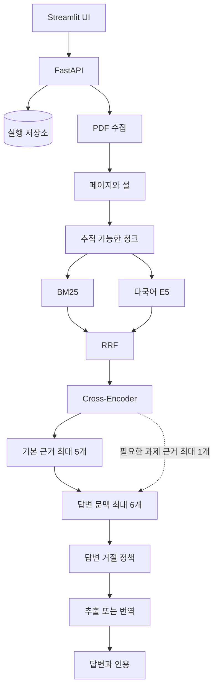

# 아키텍처

논문과 질문을 입력하면 선택한 원문, 필요한 경우 한국어 번역, 추적 가능한 인용을 반환합니다. 도식은 검색할 텍스트를 준비하는 단계, 근거를 찾고 확인하는 단계, 출처와 함께 답변을 반환하는 단계로 읽으면 됩니다. 청크는 일부 겹치도록 나눈 텍스트 조각이고, 임베딩은 의미 검색에 쓰는 수치 표현이며, 재정렬은 질문과 문단을 함께 읽는 모델로 후보 순서를 다시 고르는 과정입니다. 아래에서 각 단계가 연결되는 구현을 설명합니다.

[English](architecture.md) | [한국어](architecture_KO.md)

## 요청 흐름

1. FastAPI 백엔드가 텍스트 기반 영어 PDF 한 편을 검증하고 저장합니다.
2. 수집 파이프라인이 페이지 텍스트와 절을 추출하고 `paper_id`, 페이지, 절과 `chunk_id`를 보존한 청크를 만듭니다.
3. BM25와 다국어 E5가 선택한 논문에서 각각 후보를 검색합니다.
4. Reciprocal Rank Fusion으로 두 순위를 합친 뒤 Cross-Encoder가 20개 후보를 재정렬합니다.
5. 근거 선택기가 순위와 점수를 보존한 추적 가능한 기본 근거를 최대 5개 반환합니다.
6. 결정론적 관련도 정책이 생성 전에 답변을 거절할 수 있습니다.
7. 영어 답변은 근거 문장을 추출해 구성하고, 한국어 답변은 고정된 로컬 NLLB 모델로 선택 근거를 번역합니다.
8. 인용은 답변 모델이 만들지 않고 검증한 원문 근거에서 최대 5개를 결정론적으로 조립합니다.

근거 기반 답변 경로는 번역 추론 전에 질문의 명시적 전제와 요청 내용을
확인합니다. 질문 유형에 따라 문맥을 배정해 목록과 인접 조건을 보존합니다.
현재 처리 규칙과 보수적인 검증의 한계는 [답변 정책](answer_policy_KO.md)에
설명했습니다.

예측 과제를 명시적으로 묻는 질문에서는 같은 논문의 이미 재정렬한 후보
20개 중 필요한 일반 서술문을 포함한 전체 청크 하나를 답변 문맥에 추가할
수 있습니다. 기본 근거 객체, 순위와 점수는 유지하며 답변 문맥은 최대
6개가 됩니다. 새로운 원문을 읽지 않으며 필요한 과제의 근거가 없으면
답변을 거부합니다.

`evidence_selection.answer_context_supplements`와
`evidence_selection.answer_context_supplement_origins`에 추가 원문을 기록합니다.
`pipeline.evidence_context`는 `primary_retrieval_count`,
`primary_retrieval_evidence_ids`, `supplement_count`, `answer_context_count`와
`supplement_origins`를 기록합니다. 파이프라인 출력의 `retrieved_evidence`는
전체 답변 문맥이며 `cited_evidence`는 검증을 통과한 실제 인용만 포함합니다.
HTTP `/question` 응답은 실제 인용을 `evidence`로 제공합니다.

## 설계 이유

- Sparse 검색은 정확한 영어 전문 용어에 강합니다.
- 다국어 Dense 검색은 한국어 질문과 영어 논문 사이의 단어 불일치를 줄입니다.
- 재정렬은 넓게 확보한 후보의 최종 순위를 개선합니다.
- 페이지와 청크 식별자를 전 과정에서 유지하므로 인용을 원문까지 추적할 수 있습니다.
- 생성 모델은 임의의 인용 ID를 선택할 수 없고, 서비스가 선택된 원문 문장에서 인용을 붙입니다.

## 실행 범위

애플리케이션은 업로드한 논문 한 편을 처리합니다. 업로드 자료와 논문별 인덱스는 비공개이며 Git에서 제외합니다. 포트폴리오 코퍼스는 평가에만 사용하고 Docker 이미지에 복사하지 않습니다. 사전학습 모델의 리비전을 고정해 사용하며 별도 미세조정은 하지 않습니다.
