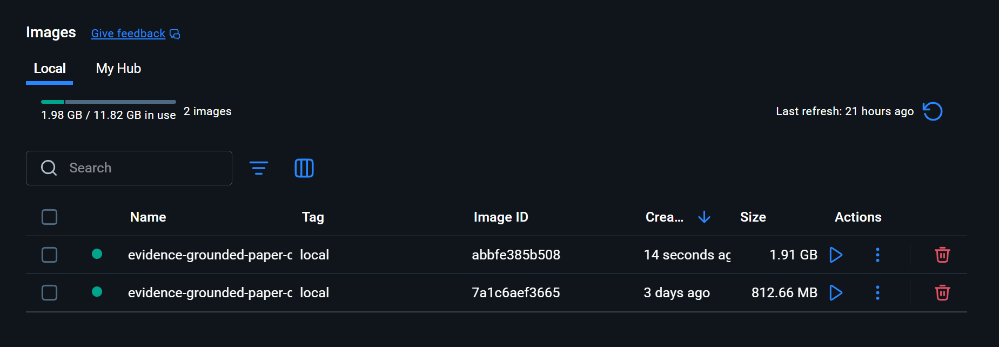

# Docker Compose Local Run

[English](docker.md) | [한국어](docker_KO.md)

## Architecture

Docker Compose builds two targets from the root `Dockerfile`.

- `backend` runs one Uvicorn worker on port 8000. It owns PDF parsing, retrieval, reranking, answer generation, and persistent runtime state.
- `ui` runs Streamlit on port 8501. It calls `http://backend:8000` through the private Compose network.

Both images run as the unprivileged `paperqna` user. Compose drops Linux capabilities, enables the no-new-privileges restriction, waits for backend health before starting the UI, and monitors both services with HTTP health checks.

The UI image only contains Streamlit and HTTP client dependencies. The backend image contains a CPU-only PyTorch runtime and the retrieval and generation dependencies. This split keeps the UI image small and avoids installing model libraries twice.

## Start and stop

Build and start the local demo:

```bash
docker compose up --build
```

Open the following addresses:

- UI: `http://127.0.0.1:8501`
- API documentation: `http://127.0.0.1:8000/docs`
- API health: `http://127.0.0.1:8000/health`

Both published ports bind to `127.0.0.1` by default, so the demo is not exposed to other devices on the network.

The first analysis may include pinned model downloads and can take several minutes. The UI waits up to 600 seconds for the background analysis job. Later analyses reuse the named model-cache volume and are normally much faster.

Stop the services while retaining uploaded-paper state and downloaded models:

```bash
docker compose down
```

Delete the two project volumes only when their contents are no longer needed:

```bash
docker compose down --volumes
```

## Environment configuration

Compose supplies runtime settings through environment variables. Defaults work without a local `.env` file. To customize them, copy `.env.example` to `.env` and edit the copy.

| Variable | Default | Purpose |
|---|---:|---|
| `PAPER_QNA_API_PORT` | `8000` | Backend port exposed on the host |
| `PAPER_QNA_UI_PORT` | `8501` | Streamlit port exposed on the host |
| `PAPER_QNA_SEED` | `378` | Reproducible application seed |
| `PAPER_QNA_MAX_PENDING_JOBS` | `16` | Maximum queued analysis jobs |
| `PAPER_QNA_PREPARE_MODELS` | `true` | Prepare search and generation models during analysis |
| `PAPER_QNA_MODEL_LOCAL_FILES_ONLY` | `false` | Prevent model downloads when all files are already cached |
| `PAPER_QNA_LOG_LEVEL` | `info` | Uvicorn log level |
| `HF_TOKEN` | empty | Optional Hugging Face token for model downloads |

The API data path and UI-to-backend address are fixed inside Compose so host-specific values do not leak into application code. Invalid integer or Boolean application settings stop the backend immediately with a clear configuration error.

Do not commit `.env`. It is ignored by Git and excluded from the Docker build context. The example contains no credential.

## Persistent data

Compose creates two named volumes:

- `paper-qna-runtime` stores private uploaded PDFs, SQLite metadata, extracted pages, chunks, and per-paper dense indexes.
- `paper-qna-model-cache` stores Hugging Face model downloads so subsequent runs can start without downloading them again.

The repository corpus, evaluation data, local implementation journal, and host `.env` are excluded from the image build context. User uploads are not copied into an image.

## Verification

Keep the Compose services running. From the repository root in the host's public clone, install the client dependencies and save a current check outside the preserved evaluation data:

```bash
python -m pip install -r requirements-test.txt
python -B scripts/check_deployment.py --base-url http://127.0.0.1:8000 --ui-url http://127.0.0.1:8501 --real-cases data/quality_benchmark/deployment/real_pdf_cases.json --output outputs/deployment/current-check.json
```

The check uploads an authored PDF and the [bundled licensed original PDF](../../data/quality_benchmark/deployment/README.md), parses them and sends supported and unsupported questions over HTTP. It checks paper-scoped citations and lexical output markers. The UI check covers its health endpoint, not browser interaction or complete answer correctness. The report records client hashes and responses, not server source or package versions; retain the server image identity and environment separately. This check verifies local deployment; public server hosting is intentionally outside the project scope.

Run this client on the host: the fixture data is not copied into either image. If custom host ports are configured, update both URLs. A first model-backed analysis can download missing pinned revisions. `PAPER_QNA_MODEL_LOCAL_FILES_ONLY=true` requires those exact revisions in the model-cache volume; leave it false for the first download. Direct Python model runs use `requirements.txt`, and their `--offline` option has the same cache requirement.

`evaluate_container.py` is a historical developer tool with the fixed output `data/evaluation/container_results.json`; it has no `--output` option. `validate_container.py` reads that preserved result. Keep its original bytes and use the current check above instead of regenerating historical evidence.



## Operational notes

- Keep one backend worker because the runtime directory uses a single-owner analysis worker and the loaded models are shared in process.
- The default image is CPU-only and works without an NVIDIA runtime. Local Python execution may be faster when the host GPU is available.
- The first model-enabled analysis can take longer while pinned model files are downloaded and loaded.
- If ports 8000 or 8501 are already used, set different host ports in `.env`.
- If offline mode is enabled before the model cache is populated, the first question cannot load the models.
