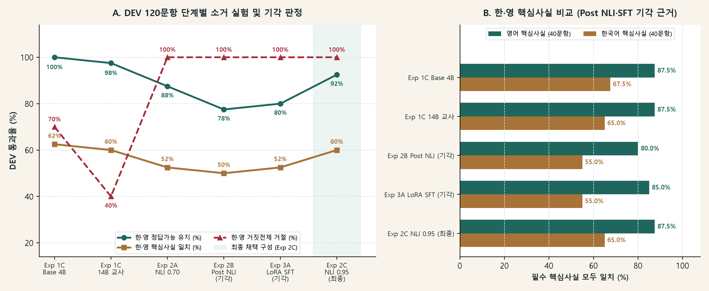
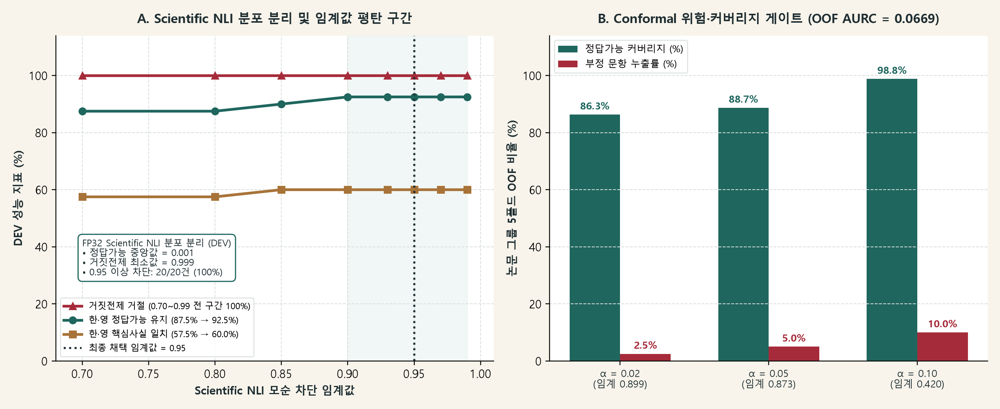

# 방법론, 소거 실험 결정 및 트러블슈팅

> **언어**: [English](methodology-and-decisions.md) | **한국어 (Korean)**

**논문 질의응답과 근거 추적(Evidence Grounded Paper Q&A)**의 모든 모델 채택, 임계값 선택, 기각 판단은 오직 `corpus30` **개발 세트(DEV 10편, 120문항: 정답가능 40쌍, 근거부족 10쌍, 거짓전제 10쌍)**에서만 수행했습니다. **미공개 평가 세트(Holdout 20편, 240문항)**는 최종 우승 구성(`Exp 2C`)을 완전히 동결한 뒤 단 1회만 평가했습니다.

---

## 1. 무누설 데이터 위생 및 외부 학습 코퍼스

1. **개발/평가 엄격 분리**: 검색 스택 선택, 생성기 비교, Scientific NLI 임계값(`0.95`), 논문 그룹 5폴드 OOF Conformal Gate 보정, 소거 기각 판정은 모두 DEV 10편에서만 확정했습니다.
2. **0% 겹침 외부 NLI 코퍼스**: `corpus30`과 논문 ID 및 제목 겹침이 0%인 외부 arXiv 논문 `150`편을 기계학습, 물리, 바이오, 시스템 분야에서 수집하고 SciFact와 결합해 한·영 `7,729`개 `(근거, 전제 가설, 라벨)` 학습 쌍을 구축했습니다.
3. **향후 검증용 동결 코퍼스 (`corpus_v2_holdout`)**: 별도 무누설 arXiv 30편(`677`청크)을 [`data/corpus_v2_holdout/freeze_v2.json`](../data/corpus_v2_holdout/freeze_v2.json)에 SHA-256 해시와 함께 동결해 CI에서 자동 무결성 검증을 수행합니다.

---

## 2. DEV 120문항 단계별 통제 소거 실험

### 단계 A: 검색 스택 A/B 및 Parent 문맥 설계 (`Exp 1B`)

DEV 정답가능 40쌍 기준 검색 비교([`reports/exp1b_retrieval_ab.json`](../reports/exp1b_retrieval_ab.json)):

| 검색 스택 (Top 5 정답 페이지 적중) | 영어 (`40`) | 한국어 (`40`) | 비고 |
| --- | ---: | ---: | --- |
| 스택 A: `BAAI/bge-m3` + `bge-reranker-v2-m3` (원문 한국어) | `38/40` (`95.0%`) | `33/40` (`82.5%`) | 다국어 밀집 검색 기준선 |
| 스택 B: `Qwen3-Embedding-0.6B` + `Qwen3-Reranker-0.6B` | `40/40` (`100.0%`) | `36/40` (`90.0%`) | 0.6B 단일 모델 기준 높은 원문 한국어 적중 |
| **최종 채택 스택**: BM25 + `BAAI/bge-m3` + `RRF(60)` + 한·영 검색어 번역 + 이중 점수 리랭킹(`0.65 EN + 0.35 KO`) + Parent 1,800자(페이지당 최대 2청크) | DEV 결합 정답 페이지 인용 `82.5%` | 청크 경계 절단 해소 | 로컬 6 GB GPU 및 L4 메모리 효율 균형 |

### 단계 B: DEV 120문항 전체 소거 비교표

모든 수치는 저장된 체크포인트에서 동일 평가기로 재산출했습니다([`reports/ablation_dev_summary.csv`](../reports/ablation_dev_summary.csv)):

| 실험 구성 (DEV 120문항) | `pair_ans` | `ko_ans` | `pair_facts` | `en / ko facts` | `unsup` | `fp (en/ko/pair)` | `quote / num` | `sec/q` | 판정 |
| --- | ---: | ---: | ---: | ---: | ---: | ---: | ---: | ---: | :---: |
| `Exp 1C`: Base `Qwen3-4B-Instruct-2507` + Guided JSON | **`40/40`** | **`40/40`** | **`25/40`** | **`35 / 27`** | `10/10` | `8 / 7 / 7` | `0.96 / 0.98` | `2.06` | 생성기 채택 |
| `Exp 1C-T`: 교사 `Qwen3-14B-AWQ` | `39/40` | `40/40` | `24/40` | `35 / 26` | `10/10` | `6 / 4 / 4` | `0.93 / 0.98` | `3.73` | 교사 상한 확인 |
| `Exp 2A`: Base 4B + FP32 Pre NLI (`0.70`) | `35/40` | `36/40` | `21/40` | `32 / 25` | `10/10` | `10 / 10 / 10` | `0.96 / 0.97` | `1.72` | 임계값 과보수 |
| `Exp 2B`: Pre NLI (`0.70`) + 2단계 Post NLI (`0.25`) | `31/40` | `32/40` | `20/40` | `32 / 22` | `10/10` | `10 / 10 / 10` | `0.97 / 0.96` | `1.73` | **기각** |
| `Exp 3A`: 5청크 LoRA SFT (`r=32`) + Pre NLI (`0.70`) | `32/40` | `33/40` | `21/40` | `34 / 22` | `10/10` | `10 / 10 / 10` | `0.93 / 0.97` | `1.83` | **기각** |
| **`Exp 2C`: Base 4B + FP32 Pre NLI (`0.95`, `post=None`)** | **`37/40`** | **`37/40`** | **`24/40`** | **`35 / 26`** | **`10/10`** | **`10 / 10 / 10`** | **`0.99 / 0.97`** | **`2.06`** | **DEV 우승** |

### 단계 C: 시스템 내부 DEV 통계 검정

Exact McNemar 및 `2,000`회 논문 군집 부트스트랩([`reports/dev_ablation_statistical_tests.csv`](../reports/dev_ablation_statistical_tests.csv)) 결과:

| DEV 비교 구간 | 평가 지표 | 이전 -> 이후 | 변화량 | 95% 군집 CI | 개선 / 손실 | Exact McNemar `p` |
| --- | --- | ---: | ---: | --- | ---: | ---: |
| `Exp 1C` -> `Exp 2C` (+FP32 Pre NLI `0.95`) | 거짓전제 거절 (`20`출력) | `0.750 -> 1.000` | **`+0.250`** | `[+0.000, +0.500]` | `+5 / -0` | `0.0625` |
| `Exp 1C` -> `Exp 2C` (+FP32 Pre NLI `0.95`) | 핵심사실 일치 (`80`출력) | `0.775 -> 0.7625` | `-0.0125` | `[-0.0375, +0.000]` | `+0 / -1` | `1.0` |
| `Exp 2A` -> `Exp 2B` (+2단계 Post NLI) | 정답 페이지 인용 (`80`출력) | `0.7375 -> 0.6375` | **`-0.100`** | `[-0.1625, -0.0375]` | `+0 / -8` | **`0.0078`** |
| `Exp 2A` -> `Exp 3A` (+LoRA SFT) | 정답가능 유지 (`80`출력) | `0.900 -> 0.850` | `-0.050` | `[-0.1125, +0.000]` | `+0 / -4` | `0.125` |

---

## 3. 실증 근거로 기각한 4가지 가설과 트러블슈팅

### 기각 1: `mDeBERTa-v3` BF16 / FP16 혼합 정밀도 학습
- **문제**: `MoritzLaurer/mDeBERTa-v3-base-mnli-xnli`를 `bf16=True`로 학습했을 때 DeBERTa-v2 상대 위치 어텐션 내부에서 NaN 기울기 붕괴가 발생해 `Exp 2B` 응답이 `0/40`으로 무너졌습니다.
- **해결**: 엄격한 **FP32 (`bf16=False, fp16=False`)** 학습과 유한 확률 가드로 교체해 `Val Loss = 0.1676`을 달성했고, DEV에서 **정답가능 모순 중앙값 `0.001` 대 거짓전제 최소값 `0.999`**(`20/20 >= 0.95`)의 깔끔한 분리를 얻었습니다.

### 기각 2: 생성 후 2단계 Post NLI 함의 필터 (`Exp 2B`)
- **문제**: 이미 Guided JSON 인용 검증을 통과한 주장을 사후 NLI 함의 확률(`>= 0.25`)로 재차 필터링하자, 거짓전제 추가 방어는 **0건**이면서 정답 페이지 인용률이 **`-10.0%p` (`p = 0.0078`)** 유의하게 하락하고 한국어 답변 `4`건(`36 -> 32`)만 잃었습니다.
- **해결**: 사후 Post NLI를 완전히 제거(`post_nli = None`)하고 결정론적 인용·수치 검증기에 책임을 집중했습니다.

### 기각 3: `Qwen3-14B-AWQ` 역합성 5청크 LoRA SFT (`Exp 3A`) 및 DPO 생략
- **문제**: 교사 상한선 평가(`Exp 1C-T`) 결과 신형 BF16 학생(`Qwen3-4B-Instruct-2507`, 핵심사실 `25/40`, 인용 `0.96`)이 이미 4비트 양자화 14B 교사(`24/40`, 인용 `0.93`, 거짓전제 `4/10`)보다 강했습니다. 약한 교사에서 합성한 `547`건(`49.4%` 거절 비율, 영문 원자 사실 필터)으로 LoRA SFT를 적용하자 한국어 핵심사실(`25 -> 22`), 인용 검증률(`0.96 -> 0.93`), 정답 유지율(`35 -> 32`)이 모두 하락했습니다.
- **해결**: LoRA 어댑터를 기각하고 후속 DPO를 생략했으며, 제로샷 `Qwen3-4B-Instruct-2507` Guided JSON을 최종 생성기로 확정했습니다.

### 기각 4: 레거시 TorchScript ONNX INT8 배포 게이트 자동 차단
- **문제**: Colab에서 내보낸 `model_quantized.onnx`(`322.67 MiB`, CPU 4스레드)를 로컬 Windows 검증기([`scripts/verify_local_runtime.py`](../scripts/verify_local_runtime.py))로 감사한 결과, 레거시 TorchScript `torch.onnx.export`와 동적 `QInt8` 양자화가 `mDeBERTa-v3` 상대 위치 어텐션의 패딩 불변성을 무너뜨렸습니다(`unpadded 0.061635` 대 `padded_384 0.098943`, `abs_diff = 0.037309 > 0.02`). 이로 인해 Holdout 거짓전제 탐지가 `2/20`에 그쳤고 지연도 `288.0 ms/창`으로 느렸습니다.
- **해결**: [`paper_qna/nli_gate.py`](../paper_qna/nli_gate.py)에 기동 시 자동 패딩 불변성 검사(`check_padding_invariance()`)를 내장해 손상된 ONNX 바이너리를 자동 차단(`onnx_int8_blocked_by_parity_gate`)하도록 구현했습니다. 반면 로컬 **RTX 3060 6 GB FP32 PyTorch** 경로는 **`abs_diff = 0.000000`**, **`1.048 GiB` VRAM**(피크 `1.610 GiB`), **`27.79 ms/창`**(CPU ONNX 대비 `10.4배` 고속)으로 통과했습니다.

---

## 4. 임계값 최적화 및 Conformal Gate 보정

1. **평탄 최적 NLI 임계 구간 (`0.90` ~ `0.99`)**: DEV 모순 임계값 스윕([`reports/nli_threshold_sweep_dev.csv`](../reports/nli_threshold_sweep_dev.csv))에서 `0.70` ~ `0.99` 전 구간 거짓전제 **`10/10` (`100%`)**을 유지하면서, `0.90` ~ `0.99` 평탄 구간에서 한·영 정답 유지가 `35/40` -> **`37/40`**, 핵심사실이 `23/40` -> **`24/40`**으로 회복되었습니다. 안정적인 중앙값 **`0.95`**를 최종 채택했습니다.
2. **논문 그룹 5폴드 OOF Conformal Gate**: `7`개 무누설 특징(`top_reranker_score`, `score_margin_1_5`, `is_ko`, `nli_max_entailment`, `nli_max_contradiction`, `quote_verified_ratio`, `numeric_verified_ratio`)을 `paper_id` 기준 `GroupKFold(5)` OOF로 보정해 **AURC `0.0669`**(`alpha=0.05`에서 커버리지 `88.7%`, 부정 누출 `5.0%`)를 달성했습니다.
