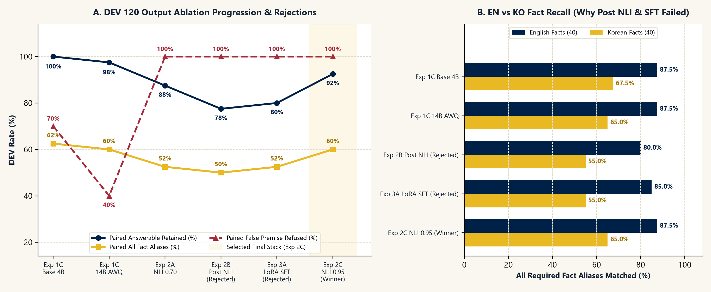
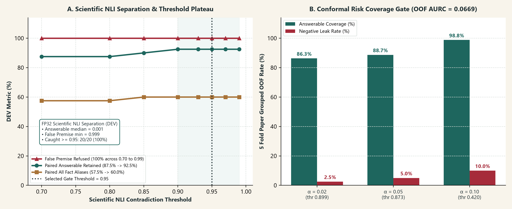

# Methodology, Ablation Decisions & Troubleshooting

> **Language**: **English** | [한국어 (Korean)](methodology-and-decisions.ko.md)

Every component of **Evidence-Grounded Paper Q&A** was selected or rejected strictly on the `corpus30` **DEV split (`10` papers, `120` outputs: `40` answerable, `10` unsupported, `10` false-premise bilingual pairs)**. The `corpus30` **Holdout split (`20` papers, `240` outputs)** remained locked until the final winning configuration (`Exp 2C`) was frozen.

---

## 1. Zero Leakage Data Hygiene & External Training Corpus

1. **Strict Split Isolation**: Model choices, threshold calibration (`0.95`), Paper Grouped 5 Fold OOF Conformal Gate fitting, and ablation rejections were conducted exclusively on DEV (`10` papers). Holdout (`20` papers) was evaluated exactly once.
2. **Zero Overlap External NLI Corpus**: To train the Scientific NLI false premise detector without touching `corpus30`, we collected `150` external arXiv papers across machine learning, physics, biomedical, and systems domains, verified `0%` ID and title overlap against `corpus30`, and combined them with SciFact to produce `7,729` bilingual EN/KO `(evidence, hypothesis, label)` training pairs.
3. **Future Validation Freeze (`corpus_v2_holdout`)**: An additional `30` unseen zero overlap arXiv papers (`677` chunks) are frozen with SHA-256 checksums in [`data/corpus_v2_holdout/freeze_v2.json`](../data/corpus_v2_holdout/freeze_v2.json) and verified in CI.

---

## 2. Staged Experimental Progression on DEV (120 Outputs)

### Stage A: Retrieval A/B & Context Window Design (`Exp 1B`)

On `40` DEV answerable bilingual pairs ([`reports/exp1b_retrieval_ab.json`](../reports/exp1b_retrieval_ab.json)):

| Retrieval Stack (Top 5 Gold Page Hit) | English (`40`) | Korean (`40`) | Notes |
| --- | ---: | ---: | --- |
| Stack A: `BAAI/bge-m3` + `bge-reranker-v2-m3` (Raw KO) | `38/40` (`95.0%`) | `33/40` (`82.5%`) | Strong multilingual dense baseline |
| Stack B: `Qwen3-Embedding-0.6B` + `Qwen3-Reranker-0.6B` | `40/40` (`100.0%`) | `36/40` (`90.0%`) | Higher raw KO retrieval at 0.6B |
| **Adopted Production Stack**: BM25 + `BAAI/bge-m3` + `RRF(60)` + KO to EN Query Translation + Dual Score Rerank (`0.65 EN + 0.35 KO`) + Parent Window (`1,800` chars, max 2/page) | `82.5%` combined DEV source page hit | Eliminates chunk boundary truncation | Balanced memory footprint on 6 GB local GPU and L4 vLLM |

### Stage B: Controlled DEV Ablation Table (`120` Outputs)

All metrics are computed identically from saved checkpoints in [`reports/ablation_dev_summary.csv`](../reports/ablation_dev_summary.csv):

| Experiment (DEV 120 Outputs) | `pair_ans` | `ko_ans` | `pair_facts` | `en / ko facts` | `unsup` | `fp (en/ko/pair)` | `quote / num` | `sec/q` | Decision |
| --- | ---: | ---: | ---: | ---: | ---: | ---: | ---: | ---: | :---: |
| `Exp 1C`: Base `Qwen3-4B-Instruct-2507` + Guided JSON | **`40/40`** | **`40/40`** | **`25/40`** | **`35 / 27`** | `10/10` | `8 / 7 / 7` | `0.96 / 0.98` | `2.06` | Adopted Generator |
| `Exp 1C-T`: Teacher `Qwen3-14B-AWQ` | `39/40` | `40/40` | `24/40` | `35 / 26` | `10/10` | `6 / 4 / 4` | `0.93 / 0.98` | `3.73` | Teacher Ceiling |
| `Exp 2A`: Base 4B + FP32 Pre NLI (`0.70`) | `35/40` | `36/40` | `21/40` | `32 / 25` | `10/10` | `10 / 10 / 10` | `0.96 / 0.97` | `1.72` | Threshold Too Strict |
| `Exp 2B`: Pre NLI (`0.70`) + 2 Stage Post NLI (`0.25`) | `31/40` | `32/40` | `20/40` | `32 / 22` | `10/10` | `10 / 10 / 10` | `0.97 / 0.96` | `1.73` | **Rejected** |
| `Exp 3A`: 5 Chunk LoRA SFT (`r=32`) + Pre NLI (`0.70`) | `32/40` | `33/40` | `21/40` | `34 / 22` | `10/10` | `10 / 10 / 10` | `0.93 / 0.97` | `1.83` | **Rejected** |
| **`Exp 2C`: Base 4B + FP32 Pre NLI (`0.95`, `post=None`)** | **`37/40`** | **`37/40`** | **`24/40`** | **`35 / 26`** | **`10/10`** | **`10 / 10 / 10`** | **`0.99 / 0.97`** | **`2.06`** | **DEV Winner** |

### Stage C: Within System DEV Statistical Tests

Exact McNemar and `2,000` iteration paper cluster bootstrap tests ([`reports/dev_ablation_statistical_tests.csv`](../reports/dev_ablation_statistical_tests.csv)) confirm the directional impact of each ablation:

| Comparison on DEV | Metric | Base -> Cand | Delta | 95% Cluster CI | Gain / Loss | Exact McNemar `p` |
| --- | --- | ---: | ---: | --- | ---: | ---: |
| `Exp 1C` -> `Exp 2C` (+FP32 Pre NLI `0.95`) | `false_premise_refused` (`20`) | `0.750 -> 1.000` | **`+0.250`** | `[+0.000, +0.500]` | `+5 / -0` | `0.0625` |
| `Exp 1C` -> `Exp 2C` (+FP32 Pre NLI `0.95`) | `all_fact_aliases` (`80`) | `0.775 -> 0.7625` | `-0.0125` | `[-0.0375, +0.000]` | `+0 / -1` | `1.0` |
| `Exp 2A` -> `Exp 2B` (+2 Stage Post NLI) | `acceptable_source_page_hit` (`80`) | `0.7375 -> 0.6375` | **`-0.100`** | `[-0.1625, -0.0375]` | `+0 / -8` | **`0.0078`** |
| `Exp 2A` -> `Exp 3A` (+LoRA SFT) | `answerable_retained` (`80`) | `0.900 -> 0.850` | `-0.050` | `[-0.1125, +0.000]` | `+0 / -4` | `0.125` |

---

## 3. Four Evidence Based Rejections & Root Cause Troubleshooting

### Rejection 1: BF16 / FP16 Mixed Precision Training of `mDeBERTa-v3`
- **Failure**: Training `MoritzLaurer/mDeBERTa-v3-base-mnli-xnli` under `bf16=True` triggered NaN gradient overflow inside DeBERTa-v2 Disentangled Relative Position Attention, collapsing `Exp 2B` to `0/40` answered cases.
- **Resolution**: Switched to strict **FP32 (`bf16=False, fp16=False`)** with explicit finite probability guards, achieving `Val Loss = 0.1676` and clean separation on DEV (**answerable median `0.001`** vs **false premise minimum `0.999`**, `20/20 >= 0.95`).

### Rejection 2: 2 Stage Post Generation NLI Entailment Gate (`Exp 2B`)
- **Failure**: Filtering already verified Guided JSON claims by post hoc NLI entailment (`>= 0.25`) produced **zero additional false premise defense** (`10/10` already caught by Pre NLI) while significantly cutting acceptable source page hits by **`-10.0%p` (`p = 0.0078`)** and dropping `4` Korean answers (`36 -> 32`).
- **Resolution**: Removed Post NLI (`post_nli = None`) and relied on the deterministic verbatim quote and canonical numeric verifier.

### Rejection 3: 5 Chunk LoRA SFT Distilled from `Qwen3-14B-AWQ` (`Exp 3A`) & Skipping DPO
- **Failure**: Evaluating `Qwen3-14B-AWQ` on DEV (`Exp 1C-T`) showed that the newer generation BF16 student (`Qwen3-4B-Instruct-2507`, `25/40` facts, `0.96` quote) already outperformed the quantized 14B teacher (`24/40` facts, `0.93` quote, `4/10` FP). Distilling `547` teacher samples with `49.4%` refusal balance and English only atomic fact filters pulled Korean fact recall down (`25 -> 22`), lowered quote accuracy (`0.96 -> 0.93`), and reduced answerable retention (`35 -> 32`).
- **Resolution**: Rejected the LoRA SFT adapter, skipped downstream DPO, and kept zero shot `Qwen3-4B-Instruct-2507` with Guided JSON.

### Rejection 4: Legacy TorchScript ONNX INT8 Deployment Blocked by Runtime Parity Gate
- **Failure**: Local Windows audit ([`scripts/verify_local_runtime.py`](../scripts/verify_local_runtime.py)) tested the exported `model_quantized.onnx` (`322.67 MiB`, CPU 4 threads) and found that legacy TorchScript `torch.onnx.export` + dynamic `QInt8` quantization broke `mDeBERTa-v3` relative-position attention padding invariance (`unpadded 0.061635` vs `padded_384 0.098943`, `abs_diff = 0.037309 > 0.02`). Consequently, the quantized graph caught only `2/20` Holdout false premises at `0.95` while taking `275.78 ms/window` (`2,165.64 ms/q`).
- **Resolution**: Added an automatic startup parity gate (`ScientificNLIOnnx.check_padding_invariance()`) in [`paper_qna/nli_gate.py`](../paper_qna/nli_gate.py) that blocks degraded ONNX binaries (`onnx_int8_blocked_by_parity_gate`). Verified local **RTX 3060 6 GB FP32 PyTorch** achieves exact padding invariance (`abs_diff = 0.000000`), **`1.048 GiB` VRAM** (`1.610 GiB` peak), and **`26.47 ms/window`** (`10.4x` faster than CPU ONNX).

---

## 4. Threshold Calibration & Conformal Gate Selection

1. **Flat Optimal NLI Threshold Plateau (`0.90` to `0.99`)**: Sweeping the Scientific NLI contradiction threshold across `0.70` to `0.99` on DEV ([`reports/nli_threshold_sweep_dev.csv`](../reports/nli_threshold_sweep_dev.csv)) kept false premise refusal flat at **`10/10` (`100%`)** across the entire sweep while raising paired answerable retention from `35/40` (`0.70`) to **`37/40`** (`0.90` to `0.99`) and paired facts from `23/40` to **`24/40`**. We selected the midpoint **`0.95`**.
2. **Paper Grouped 5 Fold OOF Conformal Gate**: Using `7` leakage free pipeline features (`top_reranker_score`, `score_margin_1_5`, `is_ko`, `nli_max_entailment`, `nli_max_contradiction`, `quote_verified_ratio`, `numeric_verified_ratio`), a standardized logistic model calibrated under `GroupKFold(5)` by `paper_id` achieves **OOF AURC `0.0669`** (`alpha=0.05` yields `88.7%` coverage at `5.0%` negative leak).
