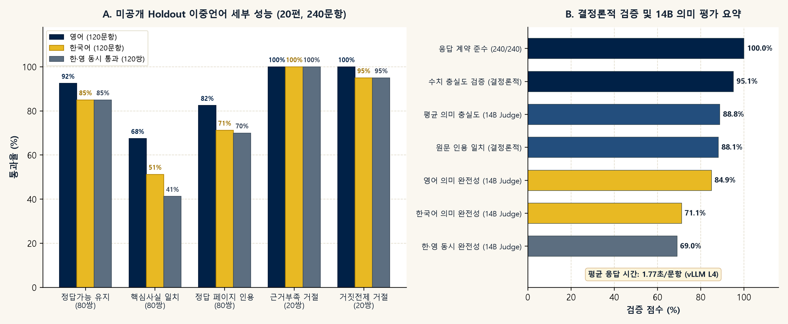
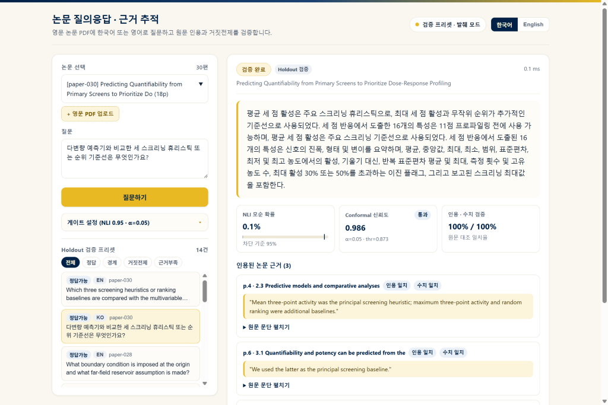

# 최종 평가 결과 및 로컬 하드웨어 검증

> **언어**: [English](results.md) | **한국어 (Korean)**

아래 모든 수치는 최종 동결된 우승 구성(`Exp 2C`: BM25 + `BAAI/bge-m3` + 이중 점수 `bge-reranker-v2-m3` + Parent `1,800`자 + FP32 `mDeBERTa-v3` Scientific NLI `0.95` + 제로샷 `Qwen/Qwen3-4B-Instruct-2507` Guided JSON + 논문 그룹 5폴드 OOF Conformal Gate)의 실측 결과입니다.

---

## 1. 미공개 `corpus30` Holdout 최종 성적 (20편, 240문항)

[`reports/holdout_breakdown.csv`](../reports/holdout_breakdown.csv) 및 [`reports/final-summary.json`](../reports/final-summary.json) 기준 세부 결과:

| 평가 지표 (미공개 Holdout, 20편) | 영어 (`120`) | 한국어 (`120`) | 한·영 동시 통과 (`120`쌍) | 전체 출력 (`240`) |
| --- | ---: | ---: | ---: | ---: |
| 응답 계약 준수 | `120/120` (`100.0%`) | `120/120` (`100.0%`) | `120/120` (`100.0%`) | **`240/240` (`100.0%`)** |
| 정답가능 유지 (`80`쌍) | `74/80` (`92.5%`) | `68/80` (`85.0%`) | **`68/80` (`85.0%`)** | **`142/160` (`88.8%`)** |
| 필수 핵심사실 일치 (`80`쌍) | `54/80` (`67.5%`) | `41/80` (`51.3%`) | **`33/80` (`41.3%`)** | **`95/160` (`59.4%`)** |
| 허용 정답 페이지 인용 (`80`쌍) | `66/80` (`82.5%`) | `57/80` (`71.3%`) | **`56/80` (`70.0%`)** | **`123/160` (`76.9%`)** |
| 근거부족 거절 (`20`쌍) | **`20/20` (`100.0%`)** | **`20/20` (`100.0%`)** | **`20/20` (`100.0%`)** | **`40/40` (`100.0%`)** |
| 거짓전제 거절 (`20`쌍) | **`20/20` (`100.0%`)** | **`19/20` (`95.0%`)** | **`19/20` (`95.0%`)** | **`39/40` (`97.5%`)** |
| 원문 인용 검증률 (결정론적) | `0.878` | `0.884` | **`0.881`** | **`0.881`** |
| 수치 충실도 검증률 (결정론적) | `0.946` | `0.957` | **`0.951`** | **`0.951`** |
| 평균 응답 시간 (`vLLM`, NVIDIA L4) | `1.81초/문항` | `1.74초/문항` | **`1.77초/문항`** | 총 `545.3초` |

### 의미 기반 루브릭 평가 (`Qwen3-14B-AWQ` Semantic Judge)

엄격한 문자열 별칭 일치율의 보수적 한계를 보완하기 위해 `Qwen3-14B-AWQ`로 정답 루브릭 대비 의미 완전성과 근거 충실도를 독립 채점했습니다.

| 평가 구간 | 영어 완전성 | 한국어 완전성 | 한·영 동시 완전성 | 평균 충실도 | 감사 시트 |
| --- | ---: | ---: | ---: | ---: | --- |
| DEV `Exp 1C` (`80` 정답가능 출력) | `0.882` | `0.842` | `0.775` | `0.867` | [`exp1c_qwen3_4b_2507_human_audit.csv`](../reports/exp1c_qwen3_4b_2507_human_audit.csv) |
| **미공개 Holdout 최종 (`160` 출력)** | **`0.849`** | **`0.711`** | **`0.690`** | **`0.888`** | [`exp4_v2_final_holdout_human_audit.csv`](../reports/exp4_v2_final_holdout_human_audit.csv) |

---

## 2. 논문 그룹 5폴드 OOF Conformal Gate 보정 결과

DEV 10편(`120`출력)에서 `paper_id` 단위 `GroupKFold(5)` OOF로 보정한 결과([`reports/calibrated_gate.json`](../reports/calibrated_gate.json)):

- **OOF AURC**: **`0.0669`**
- **Scientific NLI 사전 차단 임계값**: **`0.95`**

| 허용 위험 수준 `alpha` | OOF 확률 임계값 | 정답가능 커버리지 | 부정 문항 누출률 | 운용 모드 |
| ---: | ---: | ---: | ---: | --- |
| `0.02` | `0.8993` | `86.3%` | `2.5%` | 엄격 학술 감사 |
| **`0.05`** | **`0.8727`** | **`88.7%`** | **`5.0%`** | **권장 기본값** |
| `0.10` | `0.4196` | `98.8%` | `10.0%` | 고커버리지 탐색 |

---

## 3. 로컬 Windows RTX 3060 및 ONNX 패리티 게이트 실측 감사

**Windows 11 + NVIDIA GeForce RTX 3060 Laptop GPU (`6,144 MiB`)** 환경에서 [`scripts/verify_local_runtime.py`](../scripts/verify_local_runtime.py)를 실행해 [`reports/local_verification.json`](../reports/local_verification.json)에 기록했습니다.

| 검증 항목 | 실측 결과 | 판정 |
| --- | --- | :---: |
| `corpus_v2_holdout` SHA-256 무결성 | `chunks.jsonl`, `manifest_v2.json` (`30`편, `677`청크) `2/2` 완전 일치 | **통과** |
| 로컬 RTX 3060 FP32 PyTorch NLI (`mDeBERTa-v3`) | `1.048 GiB` VRAM (피크 `1.610 GiB` / `6.0 GiB`), `26.47 ms/창` (20창 `529.39 ms`), 패딩 불변성 **`abs_diff = 0.000000`** (`0.948831` 대 `0.948831`), 샘플 거짓전제 `0.9986` | **통과** |
| 레거시 TorchScript ONNX INT8 (`322.67 MiB`, CPU 4스레드) | 패딩 드리프트 **`abs_diff = 0.037309 > 0.02`** (`0.061635` 대 `0.098943`), Holdout 거짓전제 `2/20`만 탐지, `275.78 ms/창` (`2,165.64 ms/문항`) | **자동 차단** |
| 자동 테스트 묶음 (`pytest -v`) | `9/9` 통과 (PDF 보정, 검증기, NLI 창, BM25/RRF/Parent, Conformal Gate, SHA-256 동결, FastAPI, 실시간 경계 게이트, 패리티 게이트) | **통과** |

---

## 4. 로컬 FastAPI 인터랙티브 웹 데모 실동작 검증 (한국어 UI)

로컬 브라우저(`http://127.0.0.1:18080/`) 실동작 검증 결과:
- 콘솔 오류 0건 및 네트워크 요청 5/5 정상 응답(HTTP 200).
- 한국어 Holdout 프리셋 `paper-030-baselines-ko` 실행 시 `검증 완료 · 근거 기반 답변`, NLI 모순 확률 `0.0011`, Conformal 정답 확률 `0.986`(`alpha=0.05`, 임계 `0.873`), 인용/수치 `100% / 100%`, 문장별 원문 인용 카드 `3`건 및 Parent `1,800`자 원문 하이라이트(`3`건)가 정상 출력됨을 확인했습니다.
