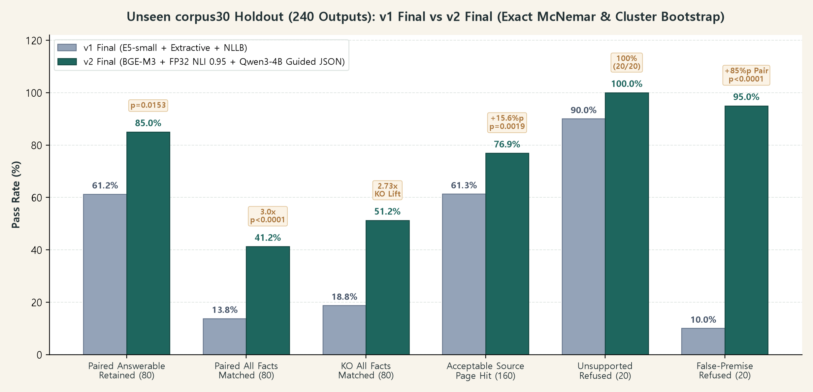
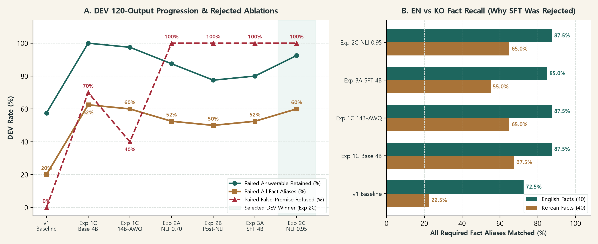
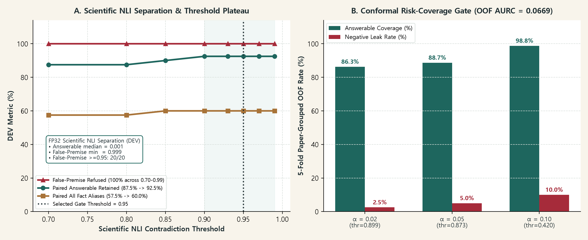

# 평가 결과 및 로컬 검증 · Evidence-Grounded Paper Q&A v2

[English](results.md) · [README](../README.ko.md) · [아키텍처](architecture.ko.md) · [방법론 및 설계 의사결정](methodology-and-decisions.ko.md) · [재현 및 데모](reproduction.ko.md)

## 1. 미공개 Holdout 최종 비교 (`corpus30`, 논문 20편 · 240출력)

모든 모델 선택, 소거 판단, 임계값(`nli_contra_threshold = 0.95`, `post_nli = None`)과 5-Fold 논문 그룹 Conformal Gate는 DEV(논문 10편, 120출력)에서만 확정한 뒤, 미공개 Holdout(논문 20편: 답변가능 80 · 근거부족 20 · 거짓전제 20 이중언어 그룹 = 240출력)을 단 1회 동결 평가했습니다.

| 지표 (미공개 Holdout 240출력) | v1 Final (기준선) | **v2 Final (`Exp 4`)** | 개선폭 및 통계 유의성 |
| :--- | ---: | ---: | :--- |
| 출력 계약 준수 (`240`출력) | `240/240` (100.0%) | **`240/240` (100.0%)** | 100% 유지 |
| 쌍체 답변가능 유지 (`80`그룹) | `49/80` (61.3%) | **`68/80` (85.0%)** | **`+19`쌍** (전체 `+11.25%p`, `p = 0.0153`) |
| 한국어 답변가능 유지 (`80`출력) | `50/80` (62.5%) | **`68/80` (85.0%)** | **`+18`건** (`+22.5%p`) |
| 쌍체 핵심사실 어휘 전원 일치 (`80`그룹) | `11/80` (13.8%) | **`33/80` (41.3%)** | **`3.0배` 향상** (전체 `+23.13%p`, `p = 3.76e-05`) |
| 영어 / 한국어 핵심사실 일치 (`80`건씩) | `43 / 15` | **`54 / 41`** | **한국어 `2.73배`** (`15 → 41`) |
| 허용 정답 페이지 인용률 (`160`출력) | `61.3%` | **`76.9%`** | **`+15.62%p`** (`p = 0.0019`) |
| 쌍체 근거부족 거절 (`20`그룹) | `18/20` (90.0%) | **`20/20` (100.0%)** | **`+2`쌍** (100% 달성) |
| **거짓전제 거절 (`EN / KO / 쌍체`)** | `2 / 17 / 2` (10.0%) | **`20 / 19 / 19` (95.0%)** | **전체 `+50.0%p`** (`p = 1.10e-05`), **영어 `2/20 → 20/20`** |
| Quote / 수치 결정론 검증률 | 추출형 | **`0.88 / 0.95`** | 95% 수치 무결성 |
| Semantic Judge 완전성 (`EN / KO / 쌍체`) | 미측정 | **`0.849 / 0.711 / 0.690`** | **평균 충실도(Faithfulness) `0.888`** |
| 평균 응답 시간 (`sec/q`) | `6.76초` | **`1.77초`** | **`3.8배` 고속화** (vLLM L4) |

### Exact 양측 McNemar 및 2,000회 논문 군집 Bootstrap 95% 신뢰구간

원본 CSV: [`reports/holdout_statistical_tests.csv`](../reports/holdout_statistical_tests.csv)

| 지표 (`n`출력) | v1 비율 | v2 비율 | 차이 | 95% 군집 CI | v2 단독 승 (`n01`) | v1 단독 승 (`n10`) | Exact McNemar `p` |
| :--- | ---: | ---: | ---: | :---: | ---: | ---: | ---: |
| `answerable_retained` (`160`) | `0.7750` | **`0.8875`** | `+0.1125` | `[+0.0000, +0.2438]` | `34` | `16` | `0.01535` |
| `all_fact_aliases` (`160`) | `0.3625` | **`0.5938`** | **`+0.2313`** | `[+0.1250, +0.3500]` | `58` | `21` | **`3.76e-05`** |
| `acceptable_source_page_hit` (`160`) | `0.6125` | **`0.7688`** | **`+0.1562`** | `[+0.0375, +0.2875]` | `43` | `18` | **`0.00187`** |
| `unsupported_refused` (`40`) | `0.9500` | **`1.0000`** | `+0.0500` | `[+0.0000, +0.1250]` | `2` | `0` | `0.50000` |
| `false_premise_refused` (`40`) | `0.4750` | **`0.9750`** | **`+0.5000`** | `[+0.3994, +0.6250]` | `21` | `1` | **`1.10e-05`** |

---

## 2. DEV 소거 실험 진행표 (`10`편 · `120`출력)

원본 CSV: [`reports/ablation_dev_summary.csv`](../reports/ablation_dev_summary.csv)

| 실험 구성 (DEV 120출력) | `pair_ans` | `ko_ans` | `pair_facts` | `en / ko` | `unsup` | `fp (en/ko/pair)` | `quote/num` | `sec/q` | 판단 |
| :--- | ---: | ---: | ---: | ---: | ---: | ---: | ---: | ---: | :---: |
| `v1_final_dev` (기준선) | `23/40` | `23/40` | `8/40` | `29 / 9` | `10/10` | `0 / 9 / 0` | 추출형 | `5.34` | 기준선 |
| `Exp 1C`: Base `Qwen3-4B-2507` + Guided JSON | **`40/40`** | **`40/40`** | **`25/40`** | **`35 / 27`** | `10/10` | `8 / 7 / 7` | `0.96/0.98` | `2.06` | 생성기 채택 |
| `Exp 1C-T`: 교사 `Qwen3-14B-AWQ` | `39/40` | `40/40` | `24/40` | `35 / 26` | `10/10` | `6 / 4 / 4` | `0.93/0.98` | `3.73` | 상한선 확인 |
| `Exp 2A`: Base 4B + FP32 Pre-NLI (`0.70`) | `35/40` | `36/40` | `21/40` | `32 / 25` | `10/10` | `10 / 10 / 10` | `0.96/0.97` | `1.72` | 임계값 과보수 |
| `Exp 2B`: Pre-NLI + 집중 Post-NLI (`0.25`) | `31/40` | `32/40` | `20/40` | `32 / 22` | `10/10` | `10 / 10 / 10` | `0.97/0.96` | `1.73` | **기각** |
| `Exp 3A`: 5-Chunk LoRA SFT + Pre-NLI (`0.70`) | `32/40` | `33/40` | `21/40` | `34 / 22` | `10/10` | `10 / 10 / 10` | `0.93/0.97` | `1.83` | **기각** |
| **`Exp 2C`: Base 4B + FP32 Pre-NLI (`0.95`)** | **`37/40`** | **`37/40`** | **`24/40`** | **`35 / 26`** | **`10/10`** | **`10 / 10 / 10`** | **`0.99/0.97`** | **`2.06`** | **DEV 우승** |

---

## 3. Scientific NLI 분리도 및 Paper-Grouped Conformal Gate

- **FP32 Scientific NLI (`mDeBERTa-v3`) DEV 분리도**: 정답가능 질문 모순 중앙값 **`0.001`** vs 거짓전제 질문 최소값 **`0.999`** (`20/20` 전원 `>= 0.999`). 임계값을 `0.70`에서 평탄 최적 구간(`0.90~0.99`)의 **`0.95`**로 올려 거짓전제 `10/10/10`을 유지한 채 `pair_ans 35→37/40`, `pair_facts 21→24/40`을 회수했습니다.
- **논문 그룹 5-Fold OOF Conformal Gate (`reports/calibrated_gate.json`)**:
  - **OOF AURC = `0.0669`**
  - `alpha = 0.02` (`thr = 0.8993`): 답변가능 커버리지 `86.3%`, 부정 질문 누수율 `2.5%`
  - `alpha = 0.05` (`thr = 0.8727`, 권장): **답변가능 커버리지 `88.7%`**, **부정 질문 누수율 `5.0%`**
  - `alpha = 0.10` (`thr = 0.4196`): 답변가능 커버리지 `98.8%`, 부정 질문 누수율 `10.0%`

---

## 4. 로컬 하드웨어 실측 검증 (`Windows 11 · RTX 3060 Laptop GPU 6 GB`)

원본 JSON: [`reports/local_verification.json`](../reports/local_verification.json)

| 로컬 검증 항목 | 구성 | 실측 결과 | 게이트 |
| :--- | :--- | :--- | :---: |
| **ONNX INT8 배포 게이트 감사** | `model_quantized.onnx` (`322.67 MiB`, CPU 4T, TorchScript `opset 17`) | 패딩 불변성 드리프트 `abs_diff = 0.0373` (`0.0616 → 0.0989`), Holdout 거짓전제 `2/20`만 탐지 (`288.0 ms/window`) | **자동 차단** |
| **RTX 3060 FP32 PyTorch NLI** | `mDeBERTa-v3-base` FP32 · NVIDIA RTX 3060 Laptop (`6,144 MiB`) | **`1.048 GiB` VRAM** (피크 `1.610 GiB`), 패딩 불변성 **`abs_diff = 0.000000`**, **`27.79 ms/window`** (CPU ONNX 대비 `10.4×` 고속), 거짓전제 `0.9986` | **통과** |
| **FastAPI 웹 데모 및 API** | `uvicorn` `127.0.0.1:18080`, 논문 `30`편 + Holdout 프리셋 `10`건 | `pytest 8/8` 통과, 실제 브라우저 콘솔·HTTP 오류 `0`건, 한국어 답변·거짓전제 실시간 전환 확인 | **통과** |
| **`corpus-v2-holdout` 동결** | 신규 arXiv validation 논문 `30`편 (`677`청크) | `chunks.jsonl` · `manifest_v2.json` SHA-256 `2/2` 일치 | **통과** |

> **핵심 배포 검증 발견**: `mDeBERTa-v3` Disentangled Attention이 학습 시 `BF16`에서 NaN 붕괴한 것과 같은 원리로, 레거시 TorchScript `torch.onnx.export` + 동적 `INT8` 양자화가 시퀀스 패딩 불변성을 훼손함을 로컬 패리티 게이트가 자동 차단했습니다. 반면 **RTX 3060 6 GB에서 FP32 PyTorch NLI는 단 `1.05 GiB` VRAM으로 `abs_diff = 0.000000`과 `27.8 ms/window`(`10.4배` 가속)**를 달성하며, `Qwen3-4B-Instruct-2507 Q4_K_M`(`~2.7 GiB`)과 공존할 `~4.4 GiB` 여유를 남깁니다.
