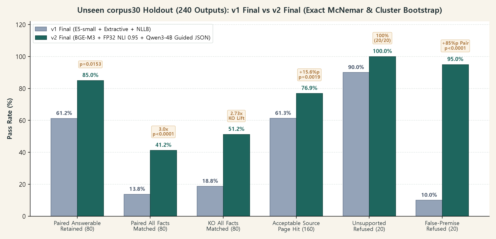
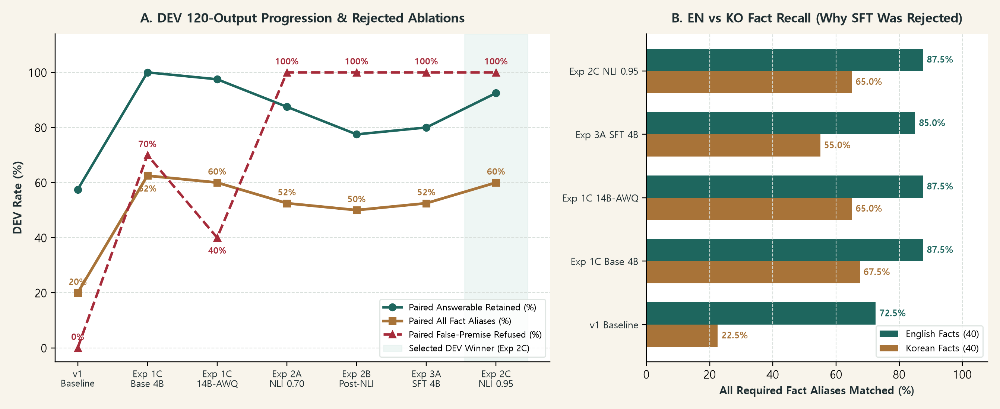
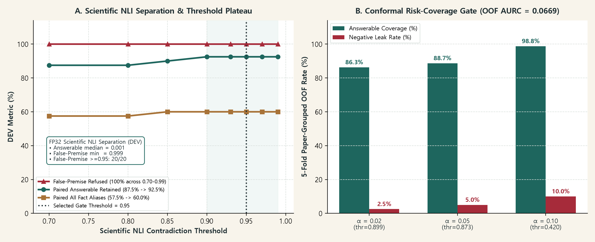

# Results & Verification · Evidence-Grounded Paper Q&A v2

[한국어](results.ko.md) · [README](../README.md) · [Architecture](architecture.md) · [Methodology & Decisions](methodology-and-decisions.md) · [Reproduction & Demo](reproduction.md)

## 1. Locked Unseen Holdout Comparison (`corpus30`, 20 Papers · 240 Outputs)

All modeling choices, ablations, thresholds (`nli_contra_threshold = 0.95`, `post_nli = None`), and the 5-fold paper-grouped Conformal Gate were fixed on DEV (`10` papers, `120` outputs) before a single locked pass on Holdout (`20` papers, `80` answerable + `20` unsupported + `20` false-premise bilingual meaning groups = `240` outputs).

| Metric (Unseen Holdout) | v1 Final (Baseline) | **v2 Final (`Exp 4`)** | Delta & Significance |
| :--- | ---: | ---: | :--- |
| Valid response contract (`240` outputs) | `240/240` (100.0%) | **`240/240` (100.0%)** | Preserved |
| Paired answerable retained (`80` groups) | `49/80` (61.3%) | **`68/80` (85.0%)** | **`+19` pairs** (`+11.25%p` all, `p = 0.0153`) |
| Korean answerable retained (`80` outputs) | `50/80` (62.5%) | **`68/80` (85.0%)** | **`+18` outputs** (`+22.5%p`) |
| Paired all required fact aliases (`80` groups) | `11/80` (13.8%) | **`33/80` (41.3%)** | **`3.0×` jump** (`+23.13%p` all, `p = 3.76e-05`) |
| English / Korean all fact aliases (`80` each) | `43 / 15` | **`54 / 41`** | **Korean `2.73×`** (`15 → 41`) |
| Acceptable source page hit (`160` outputs) | `61.3%` | **`76.9%`** | **`+15.62%p`** (`p = 0.0019`) |
| Paired unsupported refused (`20` groups) | `18/20` (90.0%) | **`20/20` (100.0%)** | **`+2` pairs** (100% refusal) |
| **False-premise refused (`EN / KO / Paired`)** | `2 / 17 / 2` (10.0%) | **`20 / 19 / 19` (95.0%)** | **`+50.0%p` all** (`p = 1.10e-05`), **EN `2/20 → 20/20`** |
| Quote / numeric deterministic verification | Extractive | **`0.88 / 0.95`** | 95% numeric fidelity |
| Semantic Judge completeness (`EN / KO / Paired`) | Not measured | **`0.849 / 0.711 / 0.690`** | **Mean faithfulness `0.888`** (`Qwen3-14B-AWQ`) |
| Mean wall latency (`sec/q`) | `6.76 s/q` | **`1.77 s/q`** | **`3.8×` faster** (vLLM L4) |

### Exact Two-Sided McNemar & 2,000-Iteration Paper-Cluster Bootstrap 95% CI

Source CSV: [`reports/holdout_statistical_tests.csv`](../reports/holdout_statistical_tests.csv)

| Metric (`n` outputs) | v1 Rate | v2 Rate | Delta | 95% Cluster CI | v2-Only Gain (`n01`) | v1-Only Loss (`n10`) | Exact McNemar `p` |
| :--- | ---: | ---: | ---: | :---: | ---: | ---: | ---: |
| `answerable_retained` (`160`) | `0.7750` | **`0.8875`** | `+0.1125` | `[+0.0000, +0.2438]` | `34` | `16` | `0.01535` |
| `all_fact_aliases` (`160`) | `0.3625` | **`0.5938`** | **`+0.2313`** | `[+0.1250, +0.3500]` | `58` | `21` | **`3.76e-05`** |
| `acceptable_source_page_hit` (`160`) | `0.6125` | **`0.7688`** | **`+0.1562`** | `[+0.0375, +0.2875]` | `43` | `18` | **`0.00187`** |
| `unsupported_refused` (`40`) | `0.9500` | **`1.0000`** | `+0.0500` | `[+0.0000, +0.1250]` | `2` | `0` | `0.50000` |
| `false_premise_refused` (`40`) | `0.4750` | **`0.9750`** | **`+0.5000`** | `[+0.3994, +0.6250]` | `21` | `1` | **`1.10e-05`** |

---

## 2. DEV Ablation Progression (`10` Papers · `120` Outputs)

Source CSV: [`reports/ablation_dev_summary.csv`](../reports/ablation_dev_summary.csv)

| Experiment (DEV 120 outputs) | `pair_ans` | `ko_ans` | `pair_facts` | `en / ko` | `unsup` | `fp (en/ko/pair)` | `quote/num` | `sec/q` | Decision |
| :--- | ---: | ---: | ---: | ---: | ---: | ---: | ---: | ---: | :---: |
| `v1_final_dev` (Baseline) | `23/40` | `23/40` | `8/40` | `29 / 9` | `10/10` | `0 / 9 / 0` | extractive | `5.34` | Baseline |
| `Exp 1C`: Base `Qwen3-4B-2507` + Guided JSON | **`40/40`** | **`40/40`** | **`25/40`** | **`35 / 27`** | `10/10` | `8 / 7 / 7` | `0.96/0.98` | `2.06` | Adopted LLM |
| `Exp 1C-T`: Teacher `Qwen3-14B-AWQ` | `39/40` | `40/40` | `24/40` | `35 / 26` | `10/10` | `6 / 4 / 4` | `0.93/0.98` | `3.73` | Ceiling Check |
| `Exp 2A`: Base 4B + FP32 Pre-NLI (`0.70`) | `35/40` | `36/40` | `21/40` | `32 / 25` | `10/10` | `10 / 10 / 10` | `0.96/0.97` | `1.72` | Threshold Low |
| `Exp 2B`: Pre-NLI + Focused Post-NLI (`0.25`) | `31/40` | `32/40` | `20/40` | `32 / 22` | `10/10` | `10 / 10 / 10` | `0.97/0.96` | `1.73` | **Rejected** |
| `Exp 3A`: 5-Chunk LoRA SFT + Pre-NLI (`0.70`) | `32/40` | `33/40` | `21/40` | `34 / 22` | `10/10` | `10 / 10 / 10` | `0.93/0.97` | `1.83` | **Rejected** |
| **`Exp 2C`: Base 4B + FP32 Pre-NLI (`0.95`)** | **`37/40`** | **`37/40`** | **`24/40`** | **`35 / 26`** | **`10/10`** | **`10 / 10 / 10`** | **`0.99/0.97`** | **`2.06`** | **DEV Winner** |

---

## 3. Scientific NLI Separation & Paper-Grouped Conformal Gate

- **FP32 Scientific NLI (`mDeBERTa-v3`) DEV separation**: Answerable contradiction median = **`0.001`** vs. False-Premise minimum = **`0.999`** (`20/20 >= 0.999`). Raising the gate threshold from `0.70` into the flat `0.90–0.99` plateau (`0.95`) recovered `+2` answerable pairs (`35 → 37/40`) and `+3` paired fact-alias groups (`21 → 24/40`) with zero loss in false-premise defense (`10/10/10`).
- **Paper-Grouped 5-Fold OOF Conformal Gate (`reports/calibrated_gate.json`)**:
  - **OOF AURC = `0.0669`**
  - `alpha = 0.02` (`thr = 0.8993`): `86.3%` answerable coverage, `2.5%` negative leak
  - `alpha = 0.05` (`thr = 0.8727`, recommended): **`88.7%` answerable coverage**, **`5.0%` negative leak**
  - `alpha = 0.10` (`thr = 0.4196`): `98.8%` answerable coverage, `10.0%` negative leak

---

## 4. Local Hardware Verification (`Windows 11 · RTX 3060 Laptop GPU 6 GB`)

Source JSON: [`reports/local_verification.json`](../reports/local_verification.json)

| Local Runtime Check | Configuration | Measured Result | Gate |
| :--- | :--- | :--- | :---: |
| **ONNX INT8 Deployment Gate** | `model_quantized.onnx` (`322.67 MiB`, CPU 4T, TorchScript `opset 17`) | Padding drift `abs_diff = 0.0373` (`0.0616 → 0.0989`); caught only `2/20` Holdout false premises at `0.95` (`288.0 ms/window`) | **BLOCKED** |
| **RTX 3060 FP32 PyTorch NLI** | `mDeBERTa-v3-base` FP32 on NVIDIA RTX 3060 Laptop (`6,144 MiB`) | **`1.048 GiB` VRAM** (`1.610 GiB` peak), padding invariance **`abs_diff = 0.000000`**, **`27.79 ms/window`** (`10.4×` faster than CPU ONNX), sample false-premise `0.9986` | **PASS** |
| **FastAPI Web Demo & API** | `uvicorn` on `127.0.0.1:18080`, `30` papers + `10` Holdout presets | `8/8` `pytest` passing, live browser check with `0` console/HTTP errors, live preset switching & Conformal telemetry verified | **PASS** |
| **Frozen `corpus-v2-holdout`** | `30` unseen arXiv validation papers (`677` chunks) | `chunks.jsonl` & `manifest_v2.json` SHA-256 checksums `2/2` verified | **PASS** |

> **Key Deployment Finding**: Just as `mDeBERTa-v3` disentangled attention collapsed under `BF16` training, legacy TorchScript `torch.onnx.export` + dynamic `INT8` quantization broke sequence-padding invariance on `DebertaV2SelfAttention`. Our local parity gate caught and blocked the degraded ONNX artifact automatically, confirming that **FP32 PyTorch on RTX 3060 (`1.05 GiB` VRAM, `27.8 ms/window`, `0.000000` padding drift)** is both cleaner and `10.4×` faster while leaving `~4.4 GiB` VRAM for `Qwen3-4B-Instruct-2507 Q4_K_M` (`~2.7 GiB`).
